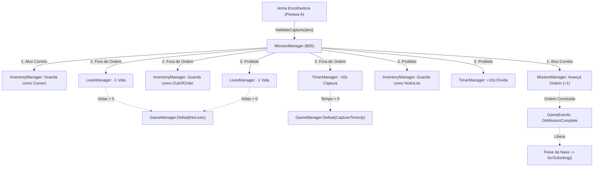

# Guia de Explicação Técnica — Tarefas da Pessoa B

> Este documento detalha a arquitetura, a lógica e o funcionamento de cada script implementado pela **Pessoa B** (Sistemas & Triagem).
> Ele foi estruturado para servir de consulta e preparação para a defesa e apresentação acadêmica do projeto.

---

## Sumário
1. [Visão Geral da Arquitetura](#visão-geral-da-arquitetura)
2. [B01 — GameManager e SceneLoader (Ciclo de Vida e Cenas)](#b01--gamemanager-e-sceneloader)
3. [B02 — InventoryManager (Inventário Persistente em Memória)](#b02--inventorymanager)
4. [B03 — TimerManager (Dois Timers e Sistema de Dívida)](#b03--timermanager)
5. [B04 — LivesManager (Controle de Vidas e Limite de Erros)](#b04--livesmanager)
6. [B05 — MissionManager (Cérebro da Missão e Validação de Captura)](#b05--missionmanager)
7. [B06 — GameEvents e Seeders de Debug (Desacoplamento e Teste Isolado)](#b06--gameevents-e-seeders-de-debug)
8. [B08 — Greybox de Triagem e ETPlayer_Sorting (Ambiente da Etapa 4)](#b08--greybox-de-triagem-e-etplayer_sorting)
9. [B09 — CaptureBoxSpawner e SortableItem (Spawning e Itens da Triagem)](#b09--captureboxspawner-e-sortableitem)
10. [Mapa de Integração entre os Sistemas](#mapa-de-integração-entre-os-sistemas)
11. [Glossário de Defesa Acadêmica](#glossário-de-defesa-acadêmica)

---

## Visão Geral da Arquitetura

Os scripts da Pessoa B formam o **núcleo (Core)** do jogo. Eles seguem três princípios arquiteturais fundamentais:

1. **Padrão Singleton (`Singleton<T>`):** Cada gerenciador possui apenas uma instância ativa no jogo todo, acessível globalmente via `Classe.Instance`.
2. **Persistência (`DontDestroyOnLoad`):** Todos os gerenciadores vivem dentro de um prefab especial chamado `[Systems]`. Ao trocar de cena, eles não são descarregados nem resetados pela Unity.
3. **Desacoplamento Orientado a Eventos (`GameEvents`):** Os sistemas conversam por eventos estáticos em C# (`event Action`). Isso significa que o `MissionManager` não precisa conhecer a interface de usuário (UI) nem o jogador diretamente para funcionar.

---

## B01 — GameManager e SceneLoader

### 1. O Problema que Resolve
Um jogo com 6 cenas (`00_Boot`, `01_BossBriefing`, `02_ShipFlight`, `03_CityHunt`, `04_ShipSorting`, `05_Results`) precisa de um coordenador central para:
- Saber em qual nível estamos (`CurrentLevel`);
- Saber para onde ir em cada transição;
- Calcular a pontuação final da fase;
- Carregar cenas sem travar a taxa de quadros (FPS) da engine.

### 2. Scripts Criados
- [`GameManager.cs`](./Assets/_Project/Scripts/Core/GameManager.cs)
- [`SceneLoader.cs`](./Assets/_Project/Scripts/Core/SceneLoader.cs)
- [`SceneTransitionUI.cs`](./Assets/_Project/Scripts/UI/SceneTransitionUI.cs)
- [`DebugGameManagerController.cs`](./Assets/_Project/Scripts/Debug/DebugGameManagerController.cs)

### 3. Detalhamento Técnico

#### `GameManager.cs`
- **`StartLevel()`:** Prepara o início da rodada. Limpa o inventário, reseta as vidas para 5, zera as dívidas de tempo, gera a missão com o chefe e carrega `01_BossBriefing`.
- **`GoToHunt()`:** Avalia a regra do diversificador:
  ```csharp
  var useShipFlight = _gameConfig != null && _gameConfig.UseShipFlight;
  var targetScene = useShipFlight ? ShipFlightSceneName : CityHuntSceneName;
  ```
  Se a nave (celular/extra) estiver desativada, pula direto para a Caça (`03_CityHunt`).
- **`GoToSorting()`:** Congela o timer da caça e carrega a cena de separação (`04_ShipSorting`).
- **`Victory()` e `Defeat(reason)`:** Param os timers, gravam o motivo da derrota (`DefeatReason`) e calculam o resultado final:
  ```csharp
  var timeScore = Mathf.RoundToInt((remainingCapture + remainingSorting) * pointsPerSecond);
  var livesScore = remainingLives * pointsPerLife;
  var totalScore = Mathf.Max(0, timeScore + livesScore);
  ```
  Armazena tudo no struct `LastResult` (`LevelResult`) para a tela de pontuação (`05_Results`) ler.

#### `SceneLoader.cs` + `SceneTransitionUI.cs`
- Usa **`SceneManager.LoadSceneAsync`** dentro de uma Coroutine. 
- Em vez de congelar a tela ao carregar arquivos pesados, ativa a tela de transição com estética de planilha (*"Salvando planilha..."*), atualiza a barra de progresso em tempo real e faz um fade-out suave ao finalizar.

### 4. Pergunta de Banca / Professor
> **P:** *"Por que usar carregamento assíncrono em vez de `SceneManager.LoadScene` comum?"*  
> **R:** *"O `LoadScene` síncrono trava a thread principal da Unity, gerando travamentos visuais perceptíveis. O `LoadSceneAsync` carrega os assets em segundo plano, permitindo animações de transição suaves e feedback para o jogador."*

---

## B02 — InventoryManager

### 1. O Problema que Resolve
Os animais são capturados na Terra (`03_CityHunt`) e precisam aparecer dentro de uma caixa na nave (`04_ShipSorting`). Se tentássemos guardar os GameObjects 3D dos animais no inventário, **todos seriam destruídos pela Unity ao trocar de cena**.

### 2. Scripts Criados
- [`InventoryManager.cs`](./Assets/_Project/Scripts/Inventory/InventoryManager.cs)
- [`CapturedItem.cs`](./Assets/_Project/Scripts/Data/CapturedItem.cs)
- [`DebugInventorySeeder.cs`](./Assets/_Project/Scripts/Debug/DebugInventorySeeder.cs)

### 3. Detalhamento Técnico
- **Armazenamento de Dados Puros (`Pure Data`):**  
  O inventário armazena instâncias do struct `CapturedItem`, contendo apenas:
  - `TargetData` (ScriptableObject com as informações do animal);
  - `CaptureResult` (se foi capturado na ordem correta, fora de ordem ou proibido).
- **Sem Alocação no Frame:** Métodos de busca como `CountByType(type)` e `Contains(data)` usam loops tradicionais `for`, sem LINQ ou expressões lambda, evitando acúmulo de lixo na memória RAM (Zero Garbage Collection).
- **Eventos:** Dispara `OnItemAdded`, `OnItemRemoved` e `OnInventoryCleared` para sincronizar a interface gráfica sem exigir consultas a cada frame no `Update`.

### 4. Pergunta de Banca / Professor
> **P:** *"Por que você guardou ScriptableObjects no inventário e não os próprios GameObjects capturados?"*  
> **R:** *"Porque GameObjects pertencem à cena ativa e são descarregados da memória ao trocar para a cena da nave. Guardando apenas os metadados via ScriptableObject, os dados persistem na memória RAM sem risco de referências nulas. A cena da nave apenas instancia os prefabs das miniaturas usando esses dados."*

---

## B03 — TimerManager

### 1. O Problema que Resolve
O jogo possui mecânicas de tempo com regras rígidas:
- A Caça e a Triagem possuem tempos diferentes e independentes;
- Erros na Caça podem penalizar o tempo da Triagem que ainda nem começou;
- O jogo proíbe ganho de tempo (o tempo nunca aumenta).

### 2. Scripts Criados
- [`TimerManager.cs`](./Assets/_Project/Scripts/Mission/TimerManager.cs)
- [`DebugTimerController.cs`](./Assets/_Project/Scripts/Debug/DebugTimerController.cs)

### 3. Detalhamento Técnico
- **Dois Relógios Isolados:** Possui `_captureRemaining` e `_sortingRemaining`. Ao iniciar a Triagem (`StartTimer(Sorting)`), o relógio da Caça é automaticamente parado.
- **Sistema de Dívida de Triagem (`SortingDebt`):**  
  Se o jogador captura o animal proibido durante a caça, a penalidade não pode descontar da caça. Ela é acumulada como dívida:
  ```csharp
  // Durante a Caça:
  SortingDebt += seconds; // acumula 10s
  
  // Ao carregar a Triagem na nave:
  var finalDuration = Mathf.Max(0f, duration - SortingDebt);
  ResetDebt();
  ```
  Assim, se a fase da nave tinha 45s, ela inicia automaticamente em 35s.
- **Gatilho de Derrota:** Se qualquer um dos timers atingir `0s`, o script interrompe o loop e aciona diretamente:
  ```csharp
  GameManager.Instance.Defeat(DefeatReason.CaptureTimeUp / SortingTimeUp);
  ```
- **Alerta de Perigo (`OnTimeLow`):** Ao descer abaixo de 15 segundos, dispara o evento global para avisar o chefe e piscar a UI em vermelho.

### 4. Pergunta de Banca / Professor
> **P:** *"Como funciona a penalidade cruzada entre a Caça e a Triagem?"*  
> **R:** *"Através do conceito de Dívida (`SortingDebt`). A penalidade é armazenada no `TimerManager` enquanto a fase de triagem não começou. Quando o método `StartTimer(Sorting)` é chamado na nave, a dívida é subtraída do tempo inicial da fase e zerada."*

---

## B04 — LivesManager

### 1. O Problema que Resolve
O jogador precisa de um limite claro de erros antes de perder a fase, impedindo tentativas infinitas ou capturas aleatórias.

### 2. Scripts Criados
- [`LivesManager.cs`](./Assets/_Project/Scripts/Mission/LivesManager.cs)
- [`DebugLivesController.cs`](./Assets/_Project/Scripts/Debug/DebugLivesController.cs)

### 3. Detalhamento Técnico
- **Contagem Padrão:** Inicia com 5 vidas (definido via `PenaltyConfig`).
- **`LoseLife()`:**
  - Reduz a contagem em 1;
  - Dispara o evento local `OnLivesChanged` (para atualizar os corações na tela);
  - Dispara o evento global `GameEvents.TriggerLifeLost(livesLeft)` (para o chefe alienígena tocar falas de irritação);
  - **Gatilho de Derrota:** Se a vida bater `0`, chama na hora:
    ```csharp
    GameManager.Instance.Defeat(DefeatReason.NoLives);
    ```

### 4. Pergunta de Banca / Professor
> **P:** *"O que acontece quando as vidas chegam a zero?"*  
> **R:** *"O `LivesManager` detecta a condição crítica, cancela novas perdas e invoca `GameManager.Instance.Defeat(DefeatReason.NoLives)`, que congela os timers restantes e redireciona o fluxo para a cena de Resultados com a bronca de derrota."*

---

## B05 — MissionManager

### 1. O Problema que Resolve
Representa o núcleo da mecânica **Matcher**:
- O chefe metódico exige uma ordem específica de animais;
- Um tipo de animal é estritamente proibido em cada nível;
- As capturas devem ser validadas em tempo real com penalidades corretas.

### 2. Scripts Criados
- [`MissionManager.cs`](./Assets/_Project/Scripts/Mission/MissionManager.cs)
- [`DebugMissionSeeder.cs`](./Assets/_Project/Scripts/Debug/DebugMissionSeeder.cs)

### 3. Detalhamento Técnico

#### Geração da Missão (`GenerateMission`)
1. Sorteia aleatoriamente 1 entre os 4 tipos como **Proibido** (`ForbiddenType`).
2. Garante que os outros 3 tipos permitidos apareçam pelo menos uma vez na lista.
3. Preenche o restante dos slots até o tamanho configurado no nível (`LevelConfig.ListSize`) e embaralha a lista aleatoriamente.

#### Validação de Captura (`ValidateCapture`)
Toda vez que a arma encolhedora atinge um alvo, o script avalia exatamente 3 cenários (Regra §R.5):

| Cenário | Resultado | Efeito no Inventário | Efeito no Progresso | Penalidade |
|---|---|---|---|---|
| **Alvo Proibido** | `NotInList` | Adicionado (`NotInList`) | Não avança | −10s de Dívida de Triagem e −1 Vida |
| **Alvo Correto na Ordem** | `Correct` | Adicionado (`Correct`) | Avança (`CurrentIndex++`) | Nenhuma penalidade |
| **Alvo Fora de Ordem** | `OutOfOrder` | Adicionado (`OutOfOrder`) | Não avança | −10s no Timer de Captura e −1 Vida |

Quando o último alvo da lista é capturado corretamente (`IsComplete == true`), ele dispara o evento `GameEvents.TriggerMissionComplete()`, liberando o feixe da nave para o jogador subir.

### 4. Pergunta de Banca / Professor
> **P:** *"Onde fica centralizada a regra do que é captura certa ou errada?"*  
> **R:** *"Exclusivamente em `MissionManager.ValidateCapture()`. A arma encolhedora e os alvos não decidem nada; eles apenas enviam o alvo atingido para o `MissionManager`, garantindo o Princípio da Responsabilidade Única (SRP)."*

---

## B06 — GameEvents e Seeders de Teste

### 1. O Problema que Resolve
- Em projetos Unity com múltiplas cenas e dois desenvolvedores trabalhando em paralelo, testar sistemas sem acoplamento exige:
  1. Uma camada de eventos global estática que não quebre quando a Unity roda sem recarregar o domínio C# (*Enter Play Mode Options*).
  2. Ferramentas de injeção de dados falsos (*Seeders*) para que a Pessoa A teste a Caça sem depender da tela de Briefing pronta, e a Pessoa B teste a Triagem sem depender da Caça pronta.

### 2. Scripts Criados / Utilizados
- [`GameEvents.cs`](./Assets/_Project/Scripts/Core/GameEvents.cs)
- [`DebugMissionSeeder.cs`](./Assets/_Project/Scripts/Debug/DebugMissionSeeder.cs)
- [`DebugInventorySeeder.cs`](./Assets/_Project/Scripts/Debug/DebugInventorySeeder.cs)

### 3. Detalhamento Técnico
- **Limpeza de Eventos Estáticos (`SubsystemRegistration`):**  
  Em C#, eventos estáticos sobrevivem enquanto a aplicação roda. Se o Unity reiniciar o Play Mode sem recarregar o domínio (opção de otimização comum no Unity 6), inscrições antigas de eventos causariam vazamento de memória e chamadas fantasmas. O método:
  ```csharp
  [RuntimeInitializeOnLoadMethod(RuntimeInitializeLoadType.SubsystemRegistration)]
  private static void ResetEvents() { ... }
  ```
  garante que todas as listas de inscritos sejam limpas a cada novo Play Mode.
- **Desacoplamento por Seeders:**  
  - `DebugInventorySeeder`: Enche o inventário com os 3 tipos de resultado (`Correct`, `OutOfOrder`, `NotInList`). Permite que a Pessoa B desenvolva e teste toda a cena de Triagem (`04_ShipSorting`) de forma 100% autônoma.
  - `DebugMissionSeeder`: Gera uma missão determinística com lista e animal proibido para que a Pessoa A possa testar a cidade (`03_CityHunt`) e o spawn de alvos (`TargetSpawner`) de forma autônoma.

### 4. Pergunta de Banca / Professor
> **P:** *"Por que usar eventos estáticos e por que limpá-los em SubsystemRegistration?"*  
---

## B08 — Greybox de Triagem e ETPlayer_Sorting

### 1. O Problema que Resolve
A Etapa 4 do jogo (Triagem / *Trier*) acontece inteiramente dentro de uma sala fechada na nave espacial alienígena. Antes de programar as mecânicas de física, arremesso e separação dos bichos, é essencial ter:
1. O ambiente 3D delimitado (paredes, piso e teto para nada escapar voando pelo espaço);
2. A caixa de captura onde os alvos encolhidos serão despejados pelo inventário;
3. As 4 gaiolas identificadas para cada espécie (`Galinha`, `Vaca`, `Porco`, `Humano`) com seus receptáculos e triggers de colisão;
4. O tubo/lixeira de descarte para os alvos proibidos;
5. Uma zona de segurança (*KillZone*) para resgatar qualquer objeto que caia fora do cenário por glitch de colisão;
6. O jogador configurado em 1ª pessoa (`ETPlayer_Sorting`) com velocidade ajustada para ambiente fechado (3.5 m/s) e câmera clamped (-85° a +85°), funcionando de imediato para testes sem depender da entrega da Pessoa A.

### 2. Scripts Criados / Utilizados
- [`Cage.cs`](./Assets/_Project/Scripts/Sorting/Cage.cs)
- [`DiscardBin.cs`](./Assets/_Project/Scripts/Sorting/DiscardBin.cs)
- [`KillZoneRespawn.cs`](./Assets/_Project/Scripts/Sorting/KillZoneRespawn.cs)
- [`ETPlayerSortingController.cs`](./Assets/_Project/Scripts/Sorting/ETPlayerSortingController.cs)

### 3. Detalhamento Técnico
- **Arquitetura Modular de Prefabs (`Ship_Interior`, `Cages`, `CaptureBox`):**  
  Para garantir máxima manutenibilidade e separação de responsabilidades no projeto, a nave e os elementos de triagem foram modularizados em Prefabs:
  - `Ship_Interior.prefab`: O casco interno da nave espacial, contendo chão, teto, paredes circulares com janela frontal, ponte de comando (`Bridge`) com consoles central e laterais ergonomicamente inclinados para o centro, cadeira do piloto e iluminação ambiente;
  - `CaptureBox.prefab`: A mesa receptáculo onde os alvos capturados são gerados;
  - `Cage_*.prefab` e `DiscardBin.prefab`: 4 gaiolas padronizadas por espécie com sinalização colorida em TextMeshPro e tubo de descarte, contendo pontos de snap e ejeção;
  - `ETPlayer_Sorting.prefab`: Prefab com `CharacterController`, câmera em primeira pessoa na altura dos olhos e física ajustada.
- **Desacoplamento do Jogador (`ETPlayerSortingController`):**  
  Lê os comandos de movimentação e rotação via `InputManager.Instance.Player` quando ele existir. Caso a Pessoa A ainda não tenha entregue a classe de input, possui *fallback* transparente para o novo Input System da Unity (`Keyboard.current` e `Mouse.current`), permitindo que a Pessoa B caminhe e teste a sala imediatamente.
- **Segurança Física com `KillZoneRespawn`:**  
  Qualquer objeto ou jogador que caia no trigger abaixo do chão tem sua `linearVelocity` zerada e é reposicionado imediatamente no ponto central da nave.

### 4. Pergunta de Banca / Professor
> **P:** *"Por que modularizar a nave e as estações em prefabs separados e criar um controller dedicado para a triagem?"*  
> **R:** *"A modularidade em prefabs (`Ship_Interior`, `Cage_*`, `CaptureBox`) garante manutenibilidade e reaproveitamento limpo entre cenas sem acoplamento. O controller dedicado respeita a velocidade reduzida exigida no GDD (3.5 m/s) para o ambiente fechado da nave e desacopla o nosso desenvolvimento da entrega da Caça feito pelo outro desenvolvedor."*

---

## B09 — CaptureBoxSpawner e SortableItem

### 1. O Problema que Resolve
Conectar a fase de Caça (Etapa 3) à fase de Triagem (Etapa 4). Na Caça, os alvos atingidos pelo raio encolhedor desaparecem do mundo e são salvos como dados no `InventoryManager`. Ao carregar a sala da nave, esses dados precisam se materializar como corpos físicos 3D em miniatura dentro da caixa de captura para que o jogador possa manipulá-los e depositá-los nas gaiolas.

### 2. Scripts Criados / Utilizados
- [`CaptureBoxSpawner.cs`](./Assets/_Project/Scripts/Sorting/CaptureBoxSpawner.cs)
- [`SortableItem.cs`](./Assets/_Project/Scripts/Sorting/SortableItem.cs)

### 3. Detalhamento Técnico
- **Spawning Baseado em Inventário (`CaptureBoxSpawner`):**  
  Fica localizado na `CaptureBox` apontando para o `SpawnAnchor`. No `Start()`, lê os itens presentes em `InventoryManager.Instance.Items` e instancia o `MiniPrefab` configurado em cada `TargetData`.
- **Dispersão Física Controlada:**  
  Aplica uma leve variação aleatória na posição horizontal ($X$ e $Z$) e rotação no plano $Y$ de cada miniatura, evitando que os objetos nasçam sobrepostos no mesmo ponto e sofram explosão de colisão pela física do Unity.
- **Sincronização Reativa por Eventos:**  
  Assina os eventos `OnItemAdded` e `OnInventoryCleared` do `InventoryManager`. Se novos itens forem adicionados dinamicamente (como pelo `DebugInventorySeeder`), eles são instanciados na hora sem necessidade de checagem contínua no `Update`.
- **Rastreabilidade de Dados (`SortableItem`):**  
  Componente anexado a cada miniatura instanciada. Mantém a referência completa ao `CapturedItem` original (espécie e o resultado da captura: `Correct`, `OutOfOrder` ou `NotInList`), permitindo que as gaiolas e o descarte na próxima etapa identifiquem a validade de cada depósito.

### 4. Pergunta de Banca / Professor
> **P:** *"Como a cena de Triagem sabe quais itens foram capturados na Caça sem criar dependência direta entre os scripts das duas fases?"*  
> **R:** *"A comunicação é totalmente desacoplada através do `InventoryManager`, que reside no GameObject `[Systems]` e persiste entre as cenas (Passo 6). Ao carregar a Triagem, o `CaptureBoxSpawner` apenas consulta o inventário e instancia o `MiniPrefab` definido no ScriptableObject `TargetData` de cada item, garantindo que as duas cenas não conheçam uma a outra."*

---

## B10 — GrabController, Grabbable e HighlightOnHover

### 1. O Problema que Resolve
Na fase de Triagem (Etapa 4 / *Trier*), o ET precisa manipular fisicamente os alvos capturados em miniatura dentro da nave e organizá-los nas respectivas estações. O sistema exige:
1. Identificação visual imediata ao mirar num objeto manipulável (*Hover Highlight*);
2. Atração suave em primeira pessoa que traga o objeto para a frente da câmera sem atravessar paredes ou quebrar colisões;
3. Ajuste fino de distância de sustentação via rolagem do mouse (1.2m a 3.5m);
4. Arremesso direcional com impulso físico (14 N) para arremessar alvos nas gaiolas à distância;
5. Raio trator curvo (*Tractor Beam*) dinâmico, simulando o peso do bicho (parábola $\cap$ / vara de pescar tensionada):
   - Linha 100% reta ao clicar com o bicho na bancada;
   - Curvatura suave para cima ao erguer, proporcional à massa (Vaca > Porco/Humano > Galinha);
   - Retorno à linha reta ao apoiar de volta na bancada.
6. Ferramenta cômica em primeira pessoa: desentupidor de pia/privada (`Plunger_Viewmodel.prefab`) com o raio saindo diretamente do bocal de sucção de borracha!

### 2. Scripts Criados / Utilizados
- [`GrabController.cs`](./Assets/_Project/Scripts/Sorting/GrabController.cs)
- [`Grabbable.cs`](./Assets/_Project/Scripts/Sorting/Grabbable.cs)
- [`HighlightOnHover.cs`](./Assets/_Project/Scripts/Sorting/HighlightOnHover.cs)
- [`TractorBeamVisual.cs`](./Assets/_Project/Scripts/Sorting/TractorBeamVisual.cs)

### 3. Detalhamento Técnico
- **Física por Velocidade Linear (`Rigidbody.linearVelocity`):**  
  Para cumprir as diretrizes da Unity 6 LTS e evitar que os alvos atravessem grades ou paredes da nave, o `Grabbable` nunca altera `transform.position` diretamente. No `FixedUpdate`, calcula o vetor delta até o ponto focal na frente da câmera e aplica `rb.linearVelocity = delta * followForce`. As grades das gaiolas e paredes continuam bloqueando o objeto através do motor de física PhysX.
- **Amortecimento Angular e Arremesso Direcional:**  
  Enquanto sustentado, `angularVelocity` é amortecido suavemente com `Vector3.Lerp` para evitar giros descontrolados se o objeto raspar em obstáculos. Ao clicar com o botão direito para arremessar, qualquer velocidade residual de movimentação do jogador é zerada e um impulso vetorial limpo é aplicado via:
  ```csharp
  rb.AddForce(cam.forward * throwForce, ForceMode.Impulse);
  ```
- **Raio Trator Dinâmico com Curva de Bézier Quadrática:**  
  O feixe visual utiliza um `LineRenderer` com 18 segmentos calculados por interpolação de Bézier:
  $$B(t) = (1-t)^2 P_0 + 2(1-t)t P_1 + t^2 P_2$$
  - $P_0$: Bocal da ventosa do desentupidor (`MuzzlePoint`);
  - $P_2$: Posição do alvo sustentado;
  - $P_1$: Ponto médio acrescido de deslocamento vertical (`Vector3.up * (archHeight * liftFactor)`).
  Quando o esforço vertical de erguer é nulo (bicho apoiado na mesa), o deslocamento é zero e a curva colapsa numa **linha 100% reta**. Ao erguer no ar, a linha ganha concavidade com abertura para baixo proporcional à espécie (Vaca: 0.65m; Porco/Humano: 0.38m; Galinha: 0.10m).
- **Viewmodel Modular (`Plunger_Viewmodel`):**  
  O desentupidor é salvo como um prefab independente na pasta de prefabs do jogador. Possui o nó de referência `MuzzlePoint` desacoplado, permitindo que a arminha ou qualquer outro modelo cômico seja trocado no futuro sem alterar o código de gameplay.

### 4. Pergunta de Banca / Professor
> **P:** *"Por que a movimentação do objeto segurado é feita via `linearVelocity` no `FixedUpdate` e não movendo o `transform.position` diretamente no `Update`?"*  
> **R:** *"Alterar `transform.position` diretamente teletransportaria o objeto a cada frame, quebrando a detecção contínua de colisão do motor PhysX e permitindo que o bicho atravessasse paredes e barras de gaiola. Usando `linearVelocity` proporcional ao delta de distância dentro do `FixedUpdate`, o objeto é atraído respeitando integralmente as colisões sólidas da nave."*

---

## B11 — Cage, DiscardBin e SortingManager

### 1. O Problema que Resolve
Implementar a regra central de negócios da Triagem (Etapa 4 / Passo 9 do GDD):
1. Processar os depósitos nas 4 gaiolas padronizadas (`Cage_Chicken`, `Cage_Cow`, `Cage_Pig`, `Cage_Human`) e no tubo de descarte (`DiscardBin`);
2. Assegurar que a validação física ocorra apenas após o jogador **soltar** o item e ele se estabilizar;
3. Aplicar rigorosamente as regras da Tabela §R.6 (alvo certo trava na gaiola; alvo errado/proibido é cuspido com força e debita 5s; descarte proibido é aceito; descarte de alvo válido retira 1 vida e debita 5s);
4. Queda com física real e natural nos fundos das estações (sem teletransporte visual e sem deletar alvos descartados do mundo);
5. Rastrear o término da triagem via `SortingManager` reativo (sem polling) e transicionar para a vitória ao esvaziar a caixa.

### 2. Scripts Criados / Utilizados
- [`Cage.cs`](./Assets/_Project/Scripts/Sorting/Cage.cs)
- [`DiscardBin.cs`](./Assets/_Project/Scripts/Sorting/DiscardBin.cs)
- [`SortingManager.cs`](./Assets/_Project/Scripts/Sorting/SortingManager.cs)
- [`CageTriggerZone.cs`](./Assets/_Project/Scripts/Sorting/CageTriggerZone.cs)
- [`DiscardTriggerZone.cs`](./Assets/_Project/Scripts/Sorting/DiscardTriggerZone.cs)

### 3. Detalhamento Técnico
- **Trigger Zones Desacopladas com Proxies:**  
  As zonas de gatilho (`TriggerZone`) residem em objetos filhos com `isTrigger = true` na Layer `CageTrigger`. Os componentes `CageTriggerZone` e `DiscardTriggerZone` atuam como proxies leves que delegam os eventos de física para o componente pai sem necessidade de `GetComponentInParent` a cada frame.
- **Validação Segura Baseada em Repouso:**  
  Em `ProcessTriggerStay(Collider other)`, o código só avalia o item se:
  - `item.IsSorted == false` (itens já processados são ignorados instantaneamente com custo zero);
  - `item.IsHeld == false` (jogador não está segurando o bicho no raio trator);
  - `item.TimeSinceReleased >= 0.20f` (o bicho já se desprendeu completamente da empunhadura).
- **Tratamento Físico de Queda e Repouso:**  
  Ao ser aceito na gaiola ou descartado na lixeira, o item não sofre teletransporte (`transform.position`). A velocidade horizontal é amortecida para concentrar a queda dentro das paredes e a gravidade acelera o corpo até o piso. Uma corrotina `SettleRoutine` monitora o repouso (`sqrMagnitude < 0.04f`) e fixa o Rigidbody (`isKinematic = true`) apenas quando assentado.
- **Ejeção Física de Erros:**  
  Alvos errados ou proibidos depositados em gaiolas sofrem `rb.AddForce` direcional para cima e para fora com 8.5 N de impulso, recebem um *cooldown* de 1.2s para evitar re-gatilhos em loop e aplicam penalidade de -5s no `TimerManager`.
- **SortingManager 100% Orientado a Eventos:**  
  Não possui método `Update()`. Escaneia os itens no `Start()` e só executa código quando notificado via `NotifyItemResolved(item)`. Quando a contagem restante zera (`RemainingItems <= 0`), aguarda a mão do jogador estar vazia e invoca `GameEvents.TriggerVictory()` e `GameManager.Instance.Victory()`.

### 4. Pergunta de Banca / Professor
> **P:** *"Por que a validação das gaiolas usa `OnTriggerStay` em vez de `OnTriggerEnter`, e como vocês garantem que isso não pese na física?"*  
> **R:** *"Se usássemos apenas `OnTriggerEnter`, um jogador que entrasse na área da gaiola ainda segurando o bicho dispararia a validação cedo demais (na mão). Se ele soltasse lá dentro, o `OnTriggerEnter` não dispararia de novo. O `OnTriggerStay` só avalia quando `IsHeld == false` e `TimeSinceReleased >= 0.2s`. Para garantir performance máxima, assim que o item é validado chamamos `item.MarkSorted()`, e a primeira linha do método é um Guard Clause (`if (item.IsSorted) return;`), descartando qualquer processamento adicional em nanossegundos."*

---

## B12 — KillZoneRespawn, Timer de Separação e HUD

### 1. O Problema que Resolve
Conectar o ciclo de tempo e a segurança física da Triagem (Passo 10 do GDD):
1. Iniciar o cronômetro da Triagem ao entrar na cena `04_ShipSorting` descontando a dívida de tempo acumulada na Caça;
2. Encerrar o cronômetro imediatamente em caso de vitória ou disparar derrota por estouro de tempo (`SortingTimeUp`) caso chegue a zero;
3. Exibir o cronômetro e a contagem de alvos restantes em um HUD 2D limpo, centralizado e visível no topo da tela;
4. Proteger a integridade da partida caso o jogador ou os alvos manipulados caiam para fora da nave no abismo espacial (`KillZoneRespawn`).

### 2. Scripts Criados / Utilizados
- [`SortingManager.cs`](./Assets/_Project/Scripts/Sorting/SortingManager.cs)
- [`KillZoneRespawn.cs`](./Assets/_Project/Scripts/Sorting/KillZoneRespawn.cs)
- [`SortingTimerUI.cs`](./Assets/_Project/Scripts/UI/SortingTimerUI.cs)
- [`TimerManager.cs`](./Assets/_Project/Scripts/Mission/TimerManager.cs)

### 3. Detalhamento Técnico
- **Início Automático com Abatimento de Dívida:**  
  No `Start()` do `SortingManager`, o tempo de triagem configurado no ScriptableObject `LevelConfig` é requisitado e repassado para `TimerManager.Instance.StartTimer(TimerPhase.Sorting, duration)`. O `TimerManager` abate a `SortingDebt` acumulada no primeiro frame e zera a dívida.
- **HUD Reativo no Topo da Tela (`SortingTimerUI`):**  
  Implementado como um Canvas `Screen Space - Overlay` escalável. Apresenta o cronômetro formatado (`MM:SS`) e o contador de alvos (`Alvos: X/Y`). Não possui método `Update()`; atualiza exclusivamente através dos eventos `TimerManager.OnTimeChanged` e `SortingManager.OnItemCountsChanged`. Quando o tempo atinge $\le 15$ segundos ou uma penalidade é aplicada (-5s por erro), os dígitos mudam para vermelho.
- **Segurança Física Completa contra Quedas (`KillZoneRespawn`):**  
  Um `BoxCollider isTrigger` de $50 \times 2 \times 50$ metros posicionado a 6 metros abaixo da nave captura qualquer entidade que atravesse o parapeito:
  - **Jogador:** Desativa momentaneamente o `CharacterController`, força o descarte de qualquer bicho seguro (`DropHeld()`), reposiciona no `RespawnPoint` central da nave e reativa o controle;
  - **Alvos Físicos:** Zera `linearVelocity` e `angularVelocity` e reposiciona o animal sobre o piso da nave, garantindo que a fase nunca se torne invencível por perda acidental de alvos no vazio.
- **Condições de Término:**  
  Se o relógio zerar, o `TimerManager` chama `GameManager.Instance.Defeat(DefeatReason.SortingTimeUp)`. Ao completar o depósito de todos os animais, o `SortingManager` para o relógio antes de transicionar para a cena de resultados.

### 4. Pergunta de Banca / Professor
> **P:** *"O que acontece se o jogador arremessar um bicho para fora da nave no abismo ou cair junto com ele?"*  
> **R:** *"A `KillZoneRespawn` abaixo da nave intercepta a colisão. Se for o jogador, soltamos o raio trator com `DropHeld()` e reposicionamos o jogador no centro da nave. Se for o bicho, a inércia física é zerada (`linearVelocity = Vector3.zero`) e ele é teleportado de volta para o chão da nave, impedindo que alvos se percam no vácuo e impossibilitem a conclusão da fase."*

---

## Mapa de Integração entre os Sistemas

Este diagrama resume como os scripts que você construiu trabalham juntos durante um disparo na Caça:



---

## Glossário de Defesa Acadêmica

Termos técnicos utilizados no código para citar na apresentação:

- **Singleton:** Padrão de projeto criacional que garante uma instância única de uma classe com ponto de acesso global.
- **DontDestroyOnLoad:** Mecanismo da Unity que preserva objetos na hierarquia através de carregamentos de cenas.
- **ScriptableObject:** Contêiner de dados que não precisa estar acoplado a um GameObject em cena, economizando memória e facilitando o balanceamento de jogo.
- **Event-Driven Architecture (EDA):** Arquitetura orientada a eventos usando C# `Action` e `event`, onde os sistemas comunicam mudanças de estado sem acoplamento direto.
- **Guard Clauses (Early Return):** Prática de engenharia de software onde validações de erro são feitas no topo dos métodos para evitar aninhamento excessivo de blocos `if/else`.
- **Zero GC Allocation:** Construção de lógicas de repetição e consultas em coleções sem gerar alocações na heap por frame, evitando coletas súbitas do Garbage Collector.
