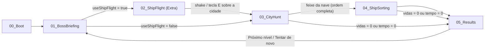

# GDD Técnico — Projeto "Abdução Metódica" (nome provisório)

> Documento de planejamento técnico (**Unity 6.3 LTS** / C#). Mecânicas: **Matcher** + **Trier**. Diversificadores: **#6 Cartridge Ready**, **#25 Shake 'N Bake**, **#26 Excellence**. Tema de humor: **Make me Laugh**.
>
> **Este documento é a fonte da verdade.** As regras de jogo estão na **§R**; os contratos de código (nomes, assinaturas) na **§C**. Se o código divergir do GDD, corrige-se o código — ou atualiza-se o GDD *primeiro*, combinando com o colega.

---

## Pendências (a definir)
| # | Item | Status |
|---|------|--------|
| P1 | Prazo de entrega / datas dos sprints | ❓ a definir |
| P2 | Limite de 10 MB (#6) | ✅ **Compilado final do jogo** (< 10 MB no arquivo compactado/zip da build entregue) |
| P3 | Como o celular conversa com o jogo no PC na Etapa 2 (#25) | ❓ a confirmar com o professor (ver Passo 13) |
| P4 | Valores de balanceamento (tempos, penalidades, tamanho das listas por nível) | 🔧 ajustar em playtest — valores iniciais na §R |

---

## §R — Regras do Jogo (decididas)

### R.1 Alvos
| Tipo (`TargetType`) | Nome PT-BR | Placeholder (protótipo) | Arte final |
|---|---|---|---|
| `Chicken` | Galinha | Esfera | low-poly |
| `Cow` | Vaca | Pirâmide (triângulo) | low-poly |
| `Pig` | Porco | Cubo (quadrado) | low-poly |
| `Human` | Humano | Cilindro | low-poly |

> A Unity não tem primitiva de pirâmide: criar um mesh simples (gerado por script `PyramidMeshGenerator` no Editor, ou um `.obj` de 5 vértices). **Não** instalar ProBuilder só para isso.

### R.2 Níveis e lista do chefe
- O jogo é dividido em **níveis**. Cada nível = Briefing → (Voo) → Caça → Triagem → Resultados.
- A cada nível a lista **aumenta** (valores iniciais, ajustáveis):

  | Nível | Tamanho da lista | Timer de Captura | Timer de Separação |
  |---|---|---|---|
  | 1 | 3 | 90 s | 45 s |
  | 2 | 4 | 100 s | 55 s |
  | 3 | 5 | 110 s | 65 s |
  | 4+ | 6, 7… | +10 s por nível | +10 s por nível |

- **Geração da lista:** em cada nível, **1 tipo é sorteado como proibido** (não aparece na lista). A lista é montada com os **outros 3 tipos**, cada um aparecendo pelo menos 1 vez; repetições são permitidas (ex.: `Vaca → Galinha → Vaca → Porco`, proibido = Humano).
- O tipo proibido **não é dito** ao jogador — ele deduz pela lista (memória).
- A lista é exibida **somente no Briefing**. Nunca aparece durante a Caça.

### R.3 Vidas
- **5 vidas** por nível (resetam ao iniciar cada nível).
- Derrota imediata quando as vidas chegam a 0.

### R.4 Timers
- **Dois timers independentes:** `Capture` (Caça) e `Sorting` (Triagem).
- **Não existe ganho de tempo** com acertos. Timers só diminuem (tempo corrido + penalidades).
- **Dívida de tempo:** uma penalidade no Timer de Separação aplicada durante a Caça é acumulada como *dívida* (mostrada na HUD como `Triagem: −10s`) e descontada quando o Timer de Separação iniciar.
- Derrota imediata se qualquer timer chegar a 0.

### R.5 Caça (Etapa 3) — resultado de cada captura
| O jogador encolhe… | Entra no inventário? | Ordem avança? | Penalidade |
|---|---|---|---|
| O alvo **certo na ordem** (`Correct`) | ✅ | ✅ | nenhuma |
| Um alvo **de um tipo presente na lista, mas fora de ordem** (`OutOfOrder`) | ✅ | ❌ (continua esperando o mesmo) | −10 s no Timer de **Captura** e −1 vida |
| Um alvo **do tipo proibido** (`NotInList`) | ✅ (vai precisar ser descartado) | ❌ | −10 s de **dívida no Timer de Separação** e −1 vida |

- Cada erro é punido **uma única vez, no momento da captura** (feedback imediato + fala do chefe).
- **Subir para a nave (feixe):** só é permitido quando a **ordem estiver completa** (todos os N alvos certos capturados em ordem). Antes disso o feixe recusa e o chefe reclama. Não há penalidade ao subir.
- As vidas limitam os erros naturalmente (no máximo 4 erros por nível).

### R.6 Triagem (Etapa 4)
- Todos os itens do inventário (certos + erros) aparecem numa caixa.
- **Gaiolas:** uma por tipo — `Galinha`, `Vaca`, `Porco`, `Humano` — **sempre as 4 presentes** + uma **lixeira de Descarte**.
- Itens `OutOfOrder` são alvos válidos → vão para a gaiola do seu tipo. Itens do tipo proibido → Descarte.

| Ação | Resultado |
|---|---|
| Item válido na gaiola do seu tipo | trava o item na gaiola (sem ganho de tempo) |
| Item na gaiola errada (inclui tipo proibido em qualquer gaiola) | item é "cuspido" de volta, −5 s no Timer de Separação |
| Item válido jogado no Descarte | item é destruído, −5 s no Timer de Separação e **−1 vida** |
| Item do tipo proibido no Descarte | correto (sem ganho de tempo) |

- A validação só acontece depois que o item é **solto** (nunca enquanto está na mão).
- Item destruído no Descarte por engano **não precisa ser reposto** — a fase termina quando a caixa e a mão estão vazias.

### R.7 Fim do nível e pontuação
- **Vitória do nível:** todos os itens processados na Triagem → `05_Results` → botão **"Próximo nível"**.
- **Derrota:** vidas = 0 **ou** algum timer = 0 → `05_Results` com bronca → botão **"Tentar de novo"** (repete o mesmo nível).
- **Pontuação do nível:** `score = (tempoRestanteCaptura + tempoRestanteSeparação) × 10 + vidasRestantes × 100`. Valores em `ScoringConfig` (ajustáveis). Pontuação total = soma dos níveis.

---

## 0. Visão Geral da Arquitetura

### 0.1 Cenas
| # | Cena | Etapa | Câmera | Controle | Escopo |
|---|------|-------|--------|----------|--------|
| 0 | `00_Boot` | Inicializa singletons persistentes | — | — | Principal |
| 1 | `01_BossBriefing` | Etapa 1 – Chefe passa a lista (UI planilha) | Fixa (UI) | Mouse | Principal |
| 2 | `02_ShipFlight` | Etapa 2 – Pilotar a nave até a cidade | 3ª pessoa | Teclado → **Celular** (giroscópio + shake) | **Fase Extra** |
| 3 | `03_CityHunt` | Etapa 3 – ETzinho caça os alvos na ordem | 1ª pessoa | Teclado + mouse | Principal |
| 4 | `04_ShipSorting` | Etapa 4 – Separar alvos em gaiolas/descarte | 1ª pessoa | Teclado + mouse | Principal |
| 5 | `05_Results` | Pontuação + bronca/elogio do chefe | UI | Mouse | Principal |

> **O celular só é usado na Etapa 2.** Todo o resto do jogo é teclado + mouse.
> Enquanto a Fase Extra não existir, `GameConfig.useShipFlight = false` e o fluxo pula direto do Briefing para a Caça.

### 0.2 Fluxo


### 0.3 Sistemas persistentes (prefab `[Systems]` em `00_Boot`, `DontDestroyOnLoad`)
- `GameManager` – estado global, nível atual, fluxo entre cenas, vitória/derrota, pontuação.
- `MissionManager` – lista do chefe, tipo proibido, ordem e validação de capturas.
- `InventoryManager` – itens capturados (com o resultado de cada captura).
- `TimerManager` – dois timers + dívida de tempo.
- `LivesManager` – vidas.
- `BossDialogueManager` – falas de humor (escuta `GameEvents`).
- `SceneLoader` – transições.
- `InputManager` – fornece `IPlayerInput` (ET) e `IShipInput` (nave).

> **Dono do prefab `[Systems]`: Pessoa B.** Todos os managers são criados (vazios) no Sprint 0, para ninguém mais precisar editar o prefab.

### 0.4 Estrutura de pastas
```
Assets/
 ├─ _Project/
 │   ├─ Scripts/{Core, Player, Ship, Targets, Inventory, Sorting, Mission, UI, Humor, Input, Data, Debug, Editor}
 │   ├─ Data/ (ScriptableObjects: TargetData, LevelConfig, CampaignConfig, BossLineSet, ScoringConfig, GameConfig)
 │   ├─ Prefabs/{Targets, Player, Ship, Cages, UI, Systems}
 │   ├─ Scenes/
 │   ├─ Materials/  Textures/  Audio/  Fonts/  Meshes/
 └─ Plugins/ (evitar ao máximo — limite de 10 MB)
```
- Namespaces: `VARG.Core`, `VARG.Player`, `VARG.Ship`, `VARG.Targets`, `VARG.Inventory`, `VARG.Sorting`, `VARG.Mission`, `VARG.UI`, `VARG.Humor`, `VARG.Input`, `VARG.Data`, `VARG.DebugTools`.

### 0.5 Notas da Unity 6.3 LTS (para o código gerado pelo Antigravity)
| Use | Não use (API antiga) |
|---|---|
| `rb.linearVelocity`, `rb.linearDamping`, `rb.angularDamping` | `rb.velocity`, `rb.drag`, `rb.angularDrag` |
| `Object.FindFirstObjectByType<T>()` / `FindObjectsByType<T>(FindObjectsSortMode.None)` | `FindObjectOfType<T>()` |
| **Input System** (`UnityEngine.InputSystem`), `InputActionAsset` | `UnityEngine.Input` (`Input.GetKey`, `Input.gyro`…) |
| `Unity.AI.Navigation.NavMeshSurface` (pacote AI Navigation) | NavMesh bake pela janela antiga |
| TextMeshPro (já incluso no pacote uGUI da Unity 6) → `TMPro.TextMeshProUGUI` | `UnityEngine.UI.Text` |
| `SceneManager.LoadSceneAsync` | `Application.LoadLevel` |

- **Player Settings → Active Input Handling = Input System Package (New).**
- **Eventos estáticos** (`GameEvents`) devem ser limpos num método `[RuntimeInitializeOnLoadMethod(RuntimeInitializeLoadType.SubsystemRegistration)]` (funciona mesmo com *Enter Play Mode Options* sem domain reload). Sempre assinar em `OnEnable` e desassinar em `OnDisable`.
- **Render pipeline:** decidir no Sprint 0 pelo tamanho da build vazia (URP mínimo vs Built-in; o Built-in ainda é suportado na 6.3). Sem Cinemachine.

---

## §C — Contratos (congelados no Sprint 0)

> Alterar qualquer item desta seção exige **combinar com o colega e atualizar o GDD antes** do código.

### C.1 Enums e dados
```csharp
public enum TargetType   { Chicken, Cow, Pig, Human }
public enum CaptureResult { Correct, OutOfOrder, NotInList }
public enum TimerPhase   { Capture, Sorting }
public enum DefeatReason { NoLives, CaptureTimeUp, SortingTimeUp }

// ScriptableObject
public class TargetData : ScriptableObject {
    public string id; public TargetType type; public string displayName;
    public GameObject prefab;      // alvo com NavMeshAgent (Etapa 3)
    public GameObject miniPrefab;  // miniatura com Rigidbody (Etapa 4)
    public Sprite icon; public float walkSpeed; public float fleeSpeed;
}

[System.Serializable]
public struct CapturedItem { public TargetData data; public CaptureResult result; }

// ScriptableObject — um por nível
public class LevelConfig : ScriptableObject {
    public int listSize; public float captureTime; public float sortingTime;
    public int extraSpawnsPerRequired; // ex.: 1
    public int forbiddenSpawnCount;    // ex.: 2–3
    public float fleeSpeedMultiplier;
}
public class CampaignConfig : ScriptableObject { public TargetData[] targets; public LevelConfig[] levels; }
public class PenaltyConfig  : ScriptableObject {
    public float outOfOrderCapturePenalty = 10f; // Timer Capture
    public float notInListSortingDebt = 10f;     // Timer Sorting (dívida)
    public float wrongCagePenalty = 5f;          // Timer Sorting
    public float wrongDiscardPenalty = 5f;       // Timer Sorting (+1 vida)
    public int startingLives = 5;
}
public class ScoringConfig : ScriptableObject { public int pointsPerSecond = 10; public int pointsPerLife = 100; }
public class GameConfig    : ScriptableObject { public bool useShipFlight = false; }
```

### C.2 Input
```csharp
// ET (Etapas 3 e 4) — somente teclado + mouse
public interface IPlayerInput {
    Vector2 Move { get; }            // WASD
    Vector2 Look { get; }            // mouse delta
    bool FirePressed { get; }        // botão esquerdo (Etapa 3: arma)
    bool GrabHeld { get; }           // botão esquerdo segurado (Etapa 4)
    bool ThrowPressed { get; }       // botão direito (Etapa 4)
    float HoldDistanceDelta { get; } // scroll (Etapa 4)
    bool InteractPressed { get; }    // E
    bool PausePressed { get; }       // Esc
}
// Nave (Etapa 2 — Fase Extra) — teclado agora, celular depois
public interface IShipInput {
    Vector2 Steer { get; }           // WASD / inclinação do celular
    bool DescendPressed { get; }     // E / shake do celular
    bool CalibratePressed { get; }   // só celular
}
```

### C.3 APIs dos managers
```csharp
MissionManager : Singleton<MissionManager>
    void GenerateMission(LevelConfig level);
    IReadOnlyList<TargetData> RequiredOrder { get; }
    TargetType ForbiddenType { get; }
    int CurrentIndex { get; }          // quantos certos já foram pegos
    int RequiredCount { get; }
    bool IsComplete { get; }
    bool IsForbidden(TargetType t);
    CaptureResult ValidateCapture(TargetData captured); // aplica penalidades, inventário e eventos

InventoryManager : Singleton<InventoryManager>
    IReadOnlyList<CapturedItem> Items { get; }
    void Add(CapturedItem item); void Remove(CapturedItem item); void Clear();
    event Action<CapturedItem> OnItemAdded, OnItemRemoved;

TimerManager : Singleton<TimerManager>
    void StartTimer(TimerPhase phase, float duration); // já desconta a dívida, se Sorting
    void StopTimer(TimerPhase phase);
    void Pause(bool paused);
    void ApplyPenalty(TimerPhase phase, float seconds); // se a fase não estiver rodando → vira dívida
    float GetRemaining(TimerPhase phase);
    float SortingDebt { get; }
    event Action<TimerPhase, float> OnTimeChanged;
    event Action<TimerPhase, float> OnPenaltyApplied;
    event Action<TimerPhase> OnTimeUp;

LivesManager : Singleton<LivesManager>
    int Lives { get; }
    void ResetLives(int amount);
    void LoseLife();                   // dispara GameEvents.OnLifeLost; em 0 → GameManager.Defeat(NoLives)
    event Action<int> OnLivesChanged;

GameManager : Singleton<GameManager>
    int CurrentLevel { get; }
    void StartLevel();                 // reset de vidas/timers/inventário + GenerateMission + carrega Briefing
    void GoToHunt();                   // respeita GameConfig.useShipFlight
    void GoToSorting(); void Victory(); void Defeat(DefeatReason reason);
    void NextLevel(); void RetryLevel();
    LevelResult LastResult { get; }    // tempos restantes, vidas, erros, score

SceneLoader : Singleton<SceneLoader>
    void Load(string sceneName);
```

### C.4 Eventos (`GameEvents`, estático)
| Evento | Payload | Disparado por |
|---|---|---|
| `OnCorrectCapture` | `TargetData` | MissionManager |
| `OnOutOfOrderCapture` | `TargetData captured, TargetData expected` | MissionManager |
| `OnNotInListCapture` | `TargetData` | MissionManager |
| `OnMissionComplete` | — | MissionManager |
| `OnBeamDenied` | — | ShipBeamZone |
| `OnCorrectCage` / `OnWrongCage` | `TargetData` | Cage |
| `OnCorrectDiscard` / `OnWrongDiscard` | `TargetData` | DiscardBin |
| `OnLifeLost` | `int livesLeft` | LivesManager |
| `OnTimeLow` | `TimerPhase` | TimerManager (≤ 15 s) |
| `OnVictory` / `OnDefeat` | — / `DefeatReason` | GameManager |
| `OnIdle` | — | BossDialogueManager (jogador parado > 20 s) |

### C.5 Layers e tags (criadas no Sprint 0)
- Layers: `Interactable` (alvos na Caça), `Grabbable` (minis na Triagem), `Player`, `CageTrigger`.
- Collision Matrix: `CageTrigger` só colide com `Grabbable`.

---

## Passo 1 — Player Controller

Há **dois controladores** (o ETzinho e a nave), cada um lendo sua interface de input.

### 1.1 `InputManager`
- Expõe `IPlayerInput Player` e `IShipInput Ship`.
- Implementações: `KeyboardMouseInput : IPlayerInput`, `KeyboardShipInput : IShipInput` (agora); `MobileShipInput : IShipInput` (Fase Extra).
- **Input System Package** com um `InputActionAsset` contendo os mapas `OnFoot`, `Ship`, `UI`.

### 1.2 `ETPlayerController` (Etapas 3 e 4 — 1ª pessoa)
- **Componentes:** `CharacterController`, `Camera` filha na altura dos olhos, `AudioListener`.
- **Lógica:**
  - Movimento planar relativo a `transform.forward/right`, gravidade manual (`velocity.y += g * dt`), sem pulo.
  - `ETCameraLook`: yaw no corpo, pitch na câmera, *clamp* de **-85° a +85°** (para ver a nave no céu).
  - `Cursor.lockState = CursorLockMode.Locked` durante o gameplay; destrava no pause/UI.
- **Etapa 4:** *Prefab Variant* `ETPlayer_Sorting` (dono: B) com velocidade reduzida, `ShrinkGun` desligado e `GrabController` ligado. **O prefab base `ETPlayer` é da A.**

### 1.3 `ShipController` (Etapa 2 — Fase Extra)
- Ver Passo 13.

### Scripts
`IPlayerInput.cs`, `IShipInput.cs`, `InputManager.cs`, `KeyboardMouseInput.cs`, `ETPlayerController.cs`, `ETCameraLook.cs`.

---

## Passo 2 — Interação com prefabs dos alvos

### Lógica
- Todos os alvos compartilham o prefab base **`Target`** com `Target.cs` (referencia um `TargetData`). No protótipo o visual é a primitiva da §R.1; depois troca-se só o modelo filho.
- Interface **`IInteractable`** (`bool CanInteract`, `void Interact(GameObject who)`, `string Prompt`).
- **`PlayerInteractor`** (na câmera do ET): `Physics.Raycast` do centro da tela, `LayerMask` `Interactable`, alcance configurável. Quando acerta, a mira muda de cor.
- Na Etapa 3 a interação é o **disparo da arma encolhedora** (Passo 3). Ao terminar de encolher, o `Target` chama `MissionManager.ValidateCapture(targetData)`, que segue **exatamente a §R.5**:
  1. Decide o `CaptureResult`.
  2. Aplica a penalidade (`TimerManager.ApplyPenalty` / `LivesManager.LoseLife`).
  3. `InventoryManager.Add(new CapturedItem{...})` — **sempre**, nos 3 casos.
  4. Avança `CurrentIndex` só se `Correct`; dispara o evento correspondente; se completou → `OnMissionComplete`.

### Componentes Unity
`CapsuleCollider`, Layer `Interactable`, `Physics.Raycast`, animação procedural simples (balanço/pulinho via script — sem `Animator`, economiza tamanho).

### Scripts
`IInteractable.cs`, `Target.cs`, `TargetData.cs` (SO), `PlayerInteractor.cs`, `CrosshairUI.cs`.

---

## Passo 3 — Redução de tamanho (Arma Encolhedora)

### Lógica
- **`ShrinkGun`** (filho da câmera): ao disparar, usa o raycast do `PlayerInteractor`, toca o efeito (`LineRenderer` + `ParticleSystem` leve) e chama `Shrinkable.StartShrink()`.
- **`Shrinkable`** (no alvo): Coroutine que interpola `transform.localScale` de 1 → 0.1 em ~0.5 s com `AnimationCurve` ("boing" cômico). Durante a redução desliga `NavMeshAgent` e `TargetAI`. Ao fim chama a validação (Passo 2) e **desativa** o objeto (pool, sem `Destroy`).
- **Cooldown** de disparo de 0.6 s (evita capturas acidentais — cada erro custa vida).
- Disparo que não acerta nada: sem penalidade (só efeito visual), mas assusta alvos próximos (`Flee`).

### Componentes Unity
`LineRenderer`, `ParticleSystem`, `AudioSource`, Coroutines, `AnimationCurve`.

### Scripts
`ShrinkGun.cs`, `Shrinkable.cs`, `ShrinkBeamFX.cs`.

---

## Passo 4 — Deslocamento dos animais (NavMesh)

### Lógica
- Pacote **AI Navigation** → **`NavMeshSurface`** na raiz da cidade; *bake* no Editor.
- Cada alvo: **`NavMeshAgent`** + **`TargetAI`** (máquina de estados):
  - `Wander`: ponto aleatório via `NavMesh.SamplePosition` num raio.
  - `Idle`: espera X segundos.
  - `Flee`: jogador a < N metros ou tiro errado perto → foge com `fleeSpeed × LevelConfig.fleeSpeedMultiplier`. Humanos fogem mais rápido que vacas.
  - `Captured`: agente desligado.
- `NavMeshObstacle` (com `carve`) em casas, carros, cercas. Limites do mapa fechados (alvos não saem da cidade).
- **`TargetSpawner`** (regra da §R.2): para cada tipo da lista com `k` ocorrências, spawna `k + extraSpawnsPerRequired`; mais `forbiddenSpawnCount` alvos do tipo proibido. Usa pontos `SpawnPoint` espalhados.
- Performance: decisões da IA a cada 0.2–0.5 s; máx. ~20 agentes.

### Componentes Unity
`NavMeshSurface`, `NavMeshAgent`, `NavMeshObstacle`, `NavMesh.SamplePosition`.

### Scripts
`TargetAI.cs`, `TargetSpawner.cs`, `SpawnPoint.cs`.

---

## Passo 5 — Inventário

### Lógica
- **`InventoryManager`** (persistente): `List<CapturedItem>` na ordem de captura. API na §C.3.
- Guarda **dados** (SO + resultado), nunca GameObjects.
- **`HuntInventoryUI` (estética de planilha – #26):** painel lateral em formato de tabela:
  | | A | B | C |
  |---|---|---|---|
  | 1 | **#** | **Alvo** | **Status** |
  | 2 | 1 | Vaca | ✔ |
  | 3 | 2 | Porco | ⚠ fora de ordem |
  | 4 | 3 | Humano | ✖ fora da lista |
  - Mostra **só o que já foi capturado** (com o status — feedback imediato do erro). **Nunca mostra o próximo alvo.**
  - Contador de progresso da ordem: `Ordem: 2/4`.
  - Barra de fórmulas no topo: `=PRÓXIMO_ALVO(#REF!)` (piada visual sem entregar a resposta).
  - Implementação: `VerticalLayoutGroup` + prefab de linha (`SpreadsheetRow`) com células (`SpreadsheetCell`).

### Scripts
`InventoryManager.cs`, `HuntInventoryUI.cs`, `SpreadsheetRow.cs`, `SpreadsheetCell.cs`.

---

## Passo 6 — Transição de cenas mantendo a lista em memória

### Lógica
- `00_Boot` contém o prefab `[Systems]` com todos os managers. `Singleton<T>` no `Awake`:
  ```
  if (Instance != null && Instance != this) { Destroy(gameObject); return; }
  Instance = this; DontDestroyOnLoad(gameObject);
  ```
- **`SceneLoader`**: `SceneManager.LoadSceneAsync` + fade em `CanvasGroup` ("Salvando planilha…" com barra de progresso – #26). Timers pausados durante a transição.
- **`PersistentBootstrapper`**: `[RuntimeInitializeOnLoadMethod(RuntimeInitializeLoadType.BeforeSceneLoad)]` instancia `[Systems]` (via `Resources.Load`) se ele não existir → dá para dar Play em qualquer cena.
- **Seeders de debug** (pasta `Scripts/Debug`, só agem se a cena foi aberta direto):
  - `DebugMissionSeeder` (em `03_CityHunt`): gera uma missão do nível 1 se `MissionManager` estiver vazio → **a A testa a Caça sem o Briefing**.
  - `DebugInventorySeeder` (em `04_ShipSorting`): enche o inventário com itens dos 3 tipos de resultado → **a B testa a Triagem sem a Caça**.
- `GameManager.StartLevel()` reseta inventário, vidas, timers e dívida.

### Componentes Unity
`DontDestroyOnLoad`, `SceneManager`, `LoadSceneAsync`, `CanvasGroup`, Build Settings (ordem das cenas).

### Scripts
`Singleton.cs`, `GameManager.cs`, `SceneLoader.cs`, `SceneTransitionUI.cs`, `PersistentBootstrapper.cs`, `DebugMissionSeeder.cs`, `DebugInventorySeeder.cs`.

---

## Passo 7 — Mecânica inversa: depósito de objetos

### Lógica
- **Volta para a nave (Etapa 3):** `ShipBeamZone` (trigger sob a nave). Se `MissionManager.IsComplete` → para o Timer de Captura → `GameManager.GoToSorting()`. Senão → `OnBeamDenied` ("Voltou com a mão abanando?"), sem penalidade.
- **Triagem (Etapa 4):** ao carregar `04_ShipSorting`, o **`CaptureBoxSpawner`** lê o `InventoryManager` e instancia o `miniPrefab` de cada `CapturedItem` dentro de uma caixa à frente do jogador.
- Cada mini tem `SortableItem` (referência ao `CapturedItem`).
- Depositar = soltar o item numa gaiola ou no Descarte (Passo 9). Item processado → `InventoryManager.Remove(item)`.
- Inventário vazio e nada na mão → `GameManager.Victory()`.

### Scripts
`ShipBeamZone.cs`, `CaptureBoxSpawner.cs`, `SortableItem.cs`.

---

## Passo 8 — Deslocamento de objetos com "Grabbing"

### Lógica
- **`GrabController`** (na câmera do `ETPlayer_Sorting`):
  - Raycast na Layer `Grabbable`; segurar botão esquerdo pega o objeto.
  - **Física por velocidade:** no `FixedUpdate`, `rb.linearVelocity = (holdPoint.position - rb.position) * força`. Não atravessa paredes das gaiolas.
  - Soltar o botão: solta. **Botão direito arremessa** (`AddForce(cam.forward * throwForce, ForceMode.Impulse)`).
  - Scroll ajusta a distância de segurar.
  - Enquanto segurado: `SortableItem.IsHeld = true`.
- Feedback: troca de material/emissão no objeto mirado (`HighlightOnHover`).
- Item que cai fora do mapa → `KillZoneRespawn` devolve à caixa.

### Componentes Unity
`Rigidbody`, `Collider`, `FixedUpdate`, `ForceMode.Impulse`, `Physics.Raycast`.

### Scripts
`GrabController.cs`, `Grabbable.cs`, `HighlightOnHover.cs`, `KillZoneRespawn.cs`.

---

## Passo 9 — Trigger boxes / Colliders das gaiolas (Trier)

### Lógica (segue a §R.6)
- **`Cage`**: paredes sólidas (`BoxCollider`), placa com o tipo (ícone + nome) e **`BoxCollider isTrigger`** interno (Layer `CageTrigger`). Campo `TargetType acceptedType`. 4 gaiolas sempre presentes.
- **`DiscardBin`**: lixeira com trigger; destrói o que entra.
- Validação em `OnTriggerStay` quando `IsHeld == false` (e item quase parado ou 0.3 s após soltar), uma única vez por item:
  - **Cage:** tipo certo **e** não proibido → trava (`isKinematic = true`, parent à gaiola), `OnCorrectCage`. Caso contrário → "cospe" (`AddForce` para cima/fora), `ApplyPenalty(Sorting, wrongCagePenalty)`, `OnWrongCage`.
  - **DiscardBin:** tipo proibido → `OnCorrectDiscard`. Item válido → `ApplyPenalty(Sorting, wrongDiscardPenalty)` + `LoseLife()` + `OnWrongDiscard`. Nos dois casos o item é destruído.
- **`SortingManager`**: conta itens restantes e chama `GameManager.Victory()`.

### Scripts
`Cage.cs`, `DiscardBin.cs`, `SortingManager.cs`.

---

## Passo 10 — Timer (perder tempo)

### Lógica
- **`TimerManager`** (persistente) — API na §C.3. Dois timers (`Capture`, `Sorting`) e `SortingDebt`.
- **Sem ganho de tempo.** Só `ApplyPenalty`. Tabela de penalidades em `PenaltyConfig` (§R.5 e §R.6).
- `Time.deltaTime`; `Pause(true)` em transições e no menu de pause (não pausa nas falas do chefe durante o gameplay).
- **Timer de Captura:** inicia ao entrar em `03_CityHunt`; para no feixe da nave.
- **Timer de Separação:** inicia ao carregar `04_ShipSorting` com `sortingTime − SortingDebt`; para no fim da Triagem.
- `OnTimeLow` a 15 s; `OnTimeUp` → `GameManager.Defeat(CaptureTimeUp / SortingTimeUp)`.
- **`TimerUI`** estilo planilha: célula com `=TEMPO_RESTANTE()` e valor; vermelha abaixo de 15 s (formatação condicional); popups "−10" (`TimeDeltaPopup`). Na Caça, mostra também a dívida `Triagem: −10s`.
- **`LivesUI`**: célula `=VIDAS()` com 5 ícones; pisca ao perder vida.

### Scripts
`TimerManager.cs`, `LivesManager.cs`, `TimerUI.cs`, `LivesUI.cs`, `TimeDeltaPopup.cs`.

---

## Passo 11 — Cena/menu com a lista para memorizar (Etapa 1)

### Lógica
- **`01_BossBriefing`**: sprite do Chefe ET + **caixa de diálogo inferior** em formato de planilha (cabeçalhos A, B, C…, linhas numeradas, barra de fórmulas com a fala).
- `GameManager.StartLevel()` chama `MissionManager.GenerateMission(levelConfig)` (regra da §R.2; seed opcional para testes).
- **`BriefingController`**: falas com efeito máquina de escrever → mostra a lista em tabela (ícone + nome + coluna "Ordem") por tempo limitado (ex.: 3 s por item) **ou** até clicar "Entendi, chefe" → esconde a lista → `GameManager.GoToHunt()`.
- Mostra o número do nível ("Planilha 3 – Nível 3").

### Componentes Unity
uGUI (`Canvas`, `GridLayoutGroup`, `TextMeshProUGUI`), `ScriptableObject`.

### Scripts
`BriefingController.cs`, `DialogueBox.cs`, `TypewriterText.cs`, `SpreadsheetTableUI.cs`.

---

## Passo 12 — Script que aciona o humor

### Lógica
- **Event-driven:** sistemas disparam `GameEvents` (§C.4); ninguém chama o chefe diretamente.
- **`BossDialogueManager`** escuta os eventos e:
  - Escolhe uma frase do `BossLineSet` correspondente, sem repetir as últimas 3 (shuffle bag).
  - Escalonamento por vidas perdidas → frases progressivamente mais irritadas (níveis 1/2/3).
  - Tokens: `"Eu pedi {expected}, e você me traz {captured}?!"`.
  - Cooldown entre falas.
- **`BossPopupUI`**: "comentário de célula" do Excel (triângulo vermelho + balão amarelo) no canto; 2–3 expressões do chefe (sprites).
- **Humor físico** (reforça o "Make me Laugh"): "boing" do encolhimento, item "cuspido" da gaiola, alvos gritando ao fugir.
- Áudio: "voz" alienígena com bipes de pitch aleatório (`AudioSource.pitch`) — zero arquivos de voz (#6).
- Textos num único `BossLineSet` (SO) → fácil de escrever e revisar.

### Scripts
`GameEvents.cs`, `BossDialogueManager.cs`, `BossLineSet.cs` (SO), `BossPopupUI.cs`, `AlienVoice.cs`.

---

## Passo 13 — Etapa 2 + Controles com o telefone (#25 Shake 'N Bake) — FASE EXTRA

> Só começa depois do loop principal completo no PC. **O celular é usado apenas nesta cena.**

### 13.1 Voo com teclado (base)
- **`ShipController`**: `Rigidbody` (`useGravity = false`, `linearDamping` alto), `AddForce` no plano XZ via `IShipInput.Steer`; *tilt* visual proporcional à velocidade; altura fixa.
- **`ShipFollowCamera`** próprio (`Vector3.SmoothDamp`) — sem Cinemachine.
- **`LandingZone`** (trigger sobre a cidade): nave dentro e quase parada → prompt "Pressione E / Chacoalhe o celular" → `DescendPressed` → `03_CityHunt`.
- Cena simples: chão, marcador da cidade, poucos obstáculos. Sem timer.

### 13.2 Celular (❓ P3 — arquitetura a confirmar com o professor)
- `MobileShipInput : IShipInput` — o resto do jogo não muda.
  - **Giroscópio** → `Steer` (com calibração da posição neutra, *deadzone* e suavização).
  - **Acelerômetro (shake)** → `DescendPressed` (limiar ~2 g, N picos em 0.5 s, cooldown).
- ⚠️ O **Unity Remote 5 só funciona dentro do Editor**, não numa build. Se o jogo final rodar no PC, é preciso uma ponte celular → PC (ex.: página web no celular enviando os sensores por WebSocket/UDP). Decidir com o professor antes de implementar.

### Scripts
`ShipController.cs`, `ShipFollowCamera.cs`, `LandingZone.cs`, `KeyboardShipInput.cs`, `MobileShipInput.cs`, `ShakeDetector.cs`, `GyroCalibrationUI.cs`.

---

## Diversificadores — Checklist Técnico

### #6 Cartridge Ready (< 10 MB)
- O limite de **< 10 MB** aplica-se ao **compilado final entregue** (o pacote/zip da build final do jogo).
- Medir a build vazia no Sprint 0 (URP mínimo vs Built-in compactado) e escolher a menor base.
- Remover pacotes não usados (Timeline, Visual Scripting, Test Framework se não usar, Collab, etc.).
- **Arte low-poly** com **paleta numa única textura 64×64** (todos os modelos num só material).
- Texturas com `Max Size` baixo, sem mipmaps na UI.
- Áudio mono, Vorbis baixa qualidade; bipes procedurais.
- 1 fonte TMP com atlas só dos caracteres usados (inclui acentos PT-BR).
- **IL2CPP + Managed Stripping Level: High**, compressão **LZ4HC** (e compactação ZIP com compressão máxima para entrega).
- Auditar com o **Build Report** (`Editor.log`) e verificar o tamanho do arquivo compactado ao fim de cada sprint.

### #25 Shake 'N Bake
- Giroscópio controla a nave; shake desce para a cidade. Só na Etapa 2. Ver Passo 13.

### #26 Excellence (estética de planilha)
- **Tema UI global:** fundo branco, grade cinza clara, cabeçalhos de coluna (A, B, C…) e linha (1, 2, 3…), fonte tipo Calibri/Arial, verde "Excel" nos destaques.
- Elementos: barra de fórmulas, abas inferiores (`Briefing | Voo | Caça | Triagem`) como indicador de progresso, comentários de célula para falas, formatação condicional no timer, células `=VIDAS()`, gráfico de barras nos Resultados.
- Prefabs reutilizáveis: `SpreadsheetPanel`, `SpreadsheetRow`, `SpreadsheetCell`, `FormulaBar`, `SheetTabs`.

---

## Lista Consolidada de Scripts

| Pasta | Scripts |
|---|---|
| Core | `Singleton<T>`, `GameManager`, `SceneLoader`, `PersistentBootstrapper`, `GameEvents` |
| Data | `TargetData`, `LevelConfig`, `CampaignConfig`, `PenaltyConfig`, `ScoringConfig`, `GameConfig`, enums (`TargetType`, `CaptureResult`, `TimerPhase`, `DefeatReason`), `CapturedItem` |
| Input | `IPlayerInput`, `IShipInput`, `InputManager`, `KeyboardMouseInput`, `KeyboardShipInput`, `MobileShipInput`, `ShakeDetector` |
| Player | `ETPlayerController`, `ETCameraLook`, `PlayerInteractor`, `ShrinkGun`, `GrabController` |
| Ship | `ShipController`, `ShipFollowCamera`, `LandingZone`, `ShipBeamZone` |
| Targets | `Target`, `TargetAI`, `Shrinkable`, `TargetSpawner`, `SpawnPoint` |
| Mission | `MissionManager`, `TimerManager`, `LivesManager` |
| Inventory | `InventoryManager` |
| Sorting | `CaptureBoxSpawner`, `SortableItem`, `Grabbable`, `Cage`, `DiscardBin`, `SortingManager`, `KillZoneRespawn` |
| Humor | `BossDialogueManager`, `BossLineSet`, `AlienVoice` |
| UI | `HuntInventoryUI`, `TimerUI`, `LivesUI`, `TimeDeltaPopup`, `CrosshairUI`, `BriefingController`, `DialogueBox`, `TypewriterText`, `BossPopupUI`, `SpreadsheetTableUI`, `SpreadsheetRow`, `SpreadsheetCell`, `SceneTransitionUI`, `ResultsScreen`, `PauseMenu`, `GyroCalibrationUI` |
| Debug | `DebugMissionSeeder`, `DebugInventorySeeder` |
| Editor | `PyramidMeshGenerator` |

## Riscos e Mitigações
| Risco | Mitigação |
|---|---|
| Build > 10 MB | Medir no Sprint 0; auditar a cada sprint; arte com paleta única; sem Cinemachine/ProBuilder. |
| Celular não conversa com a build de PC | Fase Extra isolada atrás de `IShipInput`; arquitetura decidida com o professor (P3); fallback teclado. |
| Os dois editam o mesmo arquivo/prefab/cena | Donos definidos (Tasks §Donos); `[Systems]`, layers, Build Settings e pacotes congelados no Sprint 0; Prefab Variants. |
| Código gerado com API antiga da Unity | Tabela §0.5 + `AGENTS.md`. |
| Regras implementadas de forma diferente por cada um | §R é a única fonte; `MissionManager` aplica todas as regras de captura num só lugar. |
| NavMesh com muitos agentes | Máx. ~20 agentes, IA com tick reduzido. |
| Triggers disparando com item na mão | Validar só com `IsHeld == false`. |
| Cenas testadas sem managers | `PersistentBootstrapper` + seeders de debug. |
| Alvo necessário some/foge do mapa | Spawner garante `k + extra` por tipo; limites do mapa fechados. |
