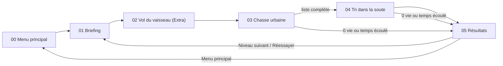
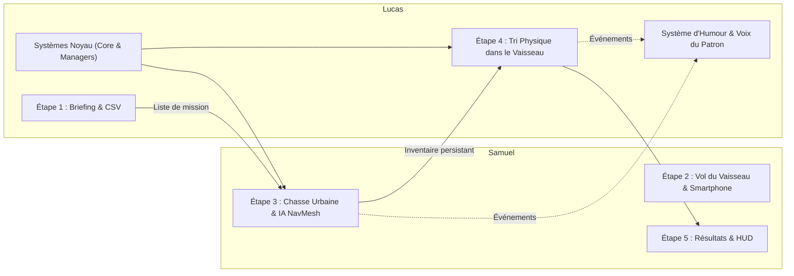

# V.A.R.G. — Abduction Méthodique

> **Projet de Jeu Vidéo (Unity 6.3 LTS)**  
> **Genre :** Action / Réflexion à la première personne (*Matcher* & *Trier*)  
> **Thème :** Humour absurde d'entreprise extraterrestre (*Make me Laugh*)  
> **Binôme :** Samuel & Lucas

---

## Résumé (TL;DR)

* **Le jeu :** un stagiaire extraterrestre reçoit de son patron sarcastique une liste ordonnée d'animaux à abduire (poule, vache, cochon, humain — une espèce est interdite). Il doit **mémoriser la liste**, capturer les cibles **dans l'ordre** en ville avec un pistolet rétrécisseur, puis **trier physiquement** ses prises dans les cages du vaisseau. Chaque erreur coûte du temps et des vies ; le patron commente tout avec un humour corporatif acide.
* **Samuel :** contrôleur joueur, chasse urbaine (pistolet rétrécisseur, IA NavMesh des animaux), HUD de chasse, écran de résultats, vol du vaisseau et contrôle par smartphone.
* **Lucas :** architecture (managers persistants, événements, données), briefing et niveaux CSV, tri physique dans le vaisseau (grabbing, cages, broyeur), système d'humour du patron.

---

## 1. Comment marche le jeu ?

### 1.1 Concept général
Dans **V.A.R.G.** (*Voluntary Alien Retrieval Group* / *Abduction Méthodique*), le joueur incarne un petit extraterrestre employé d'une corporation interstellaire bureaucratique. Sous la pression constante d'un patron sarcastique et exigeant, il est envoyé sur Terre pour abduire des spécimens terrestres précis, avant de retourner au vaisseau pour les trier physiquement dans des cages de confinement.

Le jeu repose sur deux mécaniques principales :
1. **Le Matcher (Chasse & Mémorisation) :** capturer des cibles dans un ordre précis imposé sans consulter la liste pendant la mission.
2. **Le Trier (Tri physique) :** manipuler physiquement les animaux capturés à l'intérieur du vaisseau pour les répartir selon des quotas stricts et jeter les erreurs au broyeur.

Il existe 4 types de cibles : **Poule (`Chicken`)**, **Vache (`Cow`)**, **Cochon (`Pig`)** et **Humain (`Human`)**.

### 1.2 Déroulement d'un niveau

#### Étape 1 : Le Briefing du Patron (`01_BossBriefing`)
* Le patron transmet ses ordres par dialogue et présente une vitrine visuelle temporaire (*TargetShowcaseUI*) affichant la séquence ordonnée des spécimens à capturer (ex. : *Vache → Poule → Vache → Cochon*).
* **Une espèce est systématiquement interdite** lors de chaque niveau (elle n'apparaît pas dans la commande). Le joueur doit mémoriser la liste et déduire l'intrus.
* La liste disparaît une fois le temps de consultation écoulé : le joueur doit **tout mémoriser**.

#### Étape 2 (Extra) : Le Vol du Vaisseau (`02_ShipFlight`)
* Le joueur pilote la soucoupe volante jusqu'à la zone d'atterrissage au-dessus de la ville.
* Contrôlable au clavier ou via les **capteurs d'un smartphone** (inclinaison pour diriger, secousse pour atterrir — voir §4.2).
* Un panneau à l'écran rappelle les commandes (`WASD`, `C` pour calibrer, `E` pour atterrir) et indique si le smartphone est connecté.

#### Étape 3 : La Chasse Urbaine (`03_CityHunt`)
* Vue à la première personne dans une ville habitée par des animaux autonomes (IA NavMesh). Les proies se promènent et fuient à l'approche du joueur.
* Équipé d'un pistolet rétrécisseur (*Shrink Gun*), le joueur réduit et capture les cibles :
  * **Cible correcte dans l'ordre :** validée et stockée dans l'inventaire. L'ordre avance.
  * **Cible présente mais hors-ordre :** **−10 secondes** sur le chronomètre de Chasse et **−1 vie**.
  * **Cible interdite :** **dette de temps de −10 secondes** prélevée au début du Tri, et **−1 vie**.
* Dès que toute la liste est complétée, le joueur rejoint le rayon tracteur (*ShipBeamZone*) sous le vaisseau pour monter à bord.

#### Étape 4 : Le Tri dans la Soute (`04_ShipSorting`)
* Les animaux capturés (bons spécimens comme erreurs) apparaissent dans un bac central sous forme de miniatures physiques.
* Le joueur les saisit (*Grabbing*), les approche/éloigne ou les lance :
  * **4 cages dédiées :** chacune n'accepte que le quota exact de son espèce dans la commande.
  * **Broyeur (*Discard Bin*) :** destiné aux animaux interdits et aux surplus capturés par erreur.
  * **Erreur de tri :** mauvaise cage ou quota dépassé → l'animal est renvoyé au centre avec **−5 secondes**.
  * **Erreur critique :** jeter un animal requis au broyeur → il est renvoyé au centre pour être récupéré, avec **−1 vie** et **−5 secondes**.

#### Étape 5 : Résultats & Évaluation (`05_Results`)
* Rapport d'évaluation bureaucratique (graphique à barres type tableur).
* Score : `(temps restant Chasse + temps restant Tri) × 10 + vies restantes × 100`.
* Boutons : **Niveau suivant** (en cas de victoire), **Réessayer** ou **Menu principal**. Revenir au menu remet la campagne au niveau 1.

### 1.3 Règles & décisions de design
* **Double chronomètre & dette :** deux chronomètres distincts (Chasse et Tri). Il n'existe **aucun gain de temps** lors des réussites : le temps s'écoule et diminue uniquement en cas de pénalité. Les erreurs sur cibles interdites en ville sont stockées en *dette de temps* déduite dès l'entrée dans la soute.
* **Vies :** 5 vies par niveau. Atteindre 0 vie ou voir l'un des deux chronomètres expirer entraîne une défaite immédiate.
* **Progression :** la liste s'allonge et les temps augmentent à chaque niveau de la campagne.
* **Humour :** le patron réagit à chaque événement (bonne capture, erreur d'ordre, espèce interdite, mauvaise cage, broyeur, victoire, défaite) avec des répliques sarcastiques tirées au hasard, sans répétition immédiate.

---

## 2. Démarrage rapide & contrôles

1. Ouvrir le projet dans **Unity 6.3 LTS**.
2. Lancer la scène **`00_Boot`** (`Assets/_Project/Scenes/00_Boot.unity`), puis choisir **PLAY CAMPAIGN** (campagne) ou **PLAY CUSTOM (SPREADSHEET)** (niveau CSV, voir §4.1).
   * *Note :* grâce au `PersistentBootstrapper`, il est aussi possible d'appuyer sur **Play** depuis n'importe quelle scène pour la tester isolément.

| Touche | Action |
|---|---|
| `Z Q S D` / `W A S D` | Déplacement du joueur / de la soucoupe |
| `Souris` | Orientation du regard |
| `Clic gauche` | Tirer (ville) / Saisir et lâcher un objet (soute) / Avancer un dialogue |
| `Molette` | Rapprocher ou éloigner l'objet tenu |
| `Espace` / `E` | Avancer le briefing / Atterrir en ville (vol) |
| `C` | Recalibrer la position neutre du gyroscope (vol) |

---

## 3. Répartition du travail au sein du binôme

Le développement a été réparti dès la conception selon une architecture modulaire et des contrats stricts (évitant les conflits Git et assurant l'autonomie de chacun).

### 3.1 Samuel — Chasse, IA, HUD, Résultats & Contrôles Mobiles

* **Contrôleur joueur & caméra (`ETPlayerController`, `ETCameraLook`, `KeyboardMouseInput`) :**
  * Déplacement à la première personne avec collisions et caméra limitée verticalement (±85°).
  * Intégration du nouvel *Input System* d'Unity pour le clavier/souris.
* **Interaction & pistolet rétrécisseur (`PlayerInteractor`, `ShrinkGun`, `Shrinkable`, `ShrinkBeamFX`) :**
  * Détection par lancer de rayon central (*raycast*) avec réticule réactif (`CrosshairUI`).
  * Rétrécissement progressif des cibles avec faisceau visuel, sons et délai de récupération (*cooldown*).
* **Intelligence artificielle & navigation (`TargetAI`, `TargetSpawner`, `NavMeshSurface`) :**
  * Machine à états des proies : vagabondage (*Wander*), pause (*Idle*), fuite affolée avec cris (*Flee*), capture (*Captured*).
  * Génération des cibles sur la carte en respectant les quotas et les espèces interdites.
* **Zone d'évacuation (`ShipBeamZone`) :** faisceau vers le vaisseau, actif uniquement lorsque la commande est complète.
* **HUD de chasse :**
  * `HuntInventoryUI` : progression des captures (`Targets: X/Y`).
  * `TimerUI` & `TimeDeltaPopup` : chronomètre, alerte sous 15 secondes, dette de tri et popups de pénalité (ex. *−10s*).
  * `LivesUI` : affichage des 5 vies.
* **Écran de fin de niveau (`05_Results`, `ResultsScreen`) :** synthèse des performances, score, graphique à barres façon tableur et boutons d'enchaînement.
* **Phase Extra — vol & smartphone (`02_ShipFlight`, `ShipController`, `ShipFollowCamera`, `LandingZone`, `MobileShipInput`, `ShakeDetector`, `GyroCalibrationUI`) :**
  * Pilotage de la soucoupe avec caméra de poursuite à la 3e personne.
  * Lecture des capteurs du smartphone avec calibration, zone morte et lissage ; détection des secousses pour la descente.
  * Panneau d'aide des commandes et d'état de connexion du smartphone.

### 3.2 Lucas — Architecture Système, Tri Physique, Briefing & Humour

* **Architecture & persistance (`Singleton<T>`, `PersistentBootstrapper`, `GameManager`, `SceneLoader`) :**
  * Singletons persistants (`DontDestroyOnLoad`) : un lancement depuis n'importe quelle scène charge automatiquement le conteneur `[Systems]`.
  * Machine à états globale : niveaux, victoires, défaites, transitions de scènes.
* **Bus d'événements (`GameEvents`) :** communication découplée entre tous les systèmes (sons, dialogues, timers, inventaire).
* **Données & configuration :** ScriptableObjects `TargetData`, `LevelConfig`, `CampaignConfig`, `PenaltyConfig`, `ScoringConfig`, `GameConfig` ; structures `CapturedItem`, `LevelResult` ; enums `CaptureResult`, `DefeatReason`, `TargetType`.
* **Missions, inventaire & chronomètres :**
  * `MissionManager` : génération des listes avec exclusion de l'espèce interdite, et validation centrale et unique des captures.
  * `InventoryManager` : inventaire persistant des cibles capturées et de leur statut à travers les changements de scène.
  * `TimerManager` & `LivesManager` : chronomètres indépendants, pénalités, dette de temps et décompte des 5 vies.
* **Niveau personnalisé via tableur (`SpreadsheetLevelLoader`, `SpreadsheetLevelData`, `CustomLevel.csv`) :** conception de niveaux complets dans Excel / LibreOffice Calc, avec validation des données.
* **Tri physique dans la soute (`GrabController`, `Grabbable`, `CaptureBoxSpawner`, `Cage`, `DiscardBin`, `SortingManager`) :**
  * Scène intérieure du vaisseau et apparition des miniatures dans le bac central.
  * Saisie physique en vue FPS : objets qui ne traversent pas les murs, distance à la molette, lancer et faisceau tracteur visuel (`TractorBeamVisual`).
  * Cages avec vérification des quotas au relâchement, renvoi des intrus au centre et détection des erreurs au broyeur.
* **Briefing & humour (`01_BossBriefing`, `BriefingController`, `DialogueBox`, `TargetShowcaseUI`, `BossDialogueManager`, `BossLineSet`, `BossPopupUI`) :**
  * Présentation de mission avec boîte de dialogue, avatar du patron et vitrine temporaire des cibles.
  * Répliques comiques aléatoires avec *cooldown*, insertion du nom de la cible (`{captured}`), réactions aux erreurs de capture et de tri, et voix extraterrestre.

---

## 4. Fonctionnalités avancées

### 4.1 Niveaux personnalisés via tableur CSV (`CustomLevel.csv`)

En accord avec le thème de bureaucratie extraterrestre, le jeu permet de concevoir des niveaux dans un tableur externe (Excel, LibreOffice Calc, Google Sheets ou éditeur de texte) sans recompiler le jeu.

Le fichier est situé à la racine du projet. S'il est absent, le jeu génère automatiquement un modèle documenté. Il contient 4 colonnes (`Parameter,Value,DefaultValue,Description`) et accepte les délimiteurs `,` ou `;` :

| Paramètre | Exemple | Description |
|---|---|---|
| `TargetSequence` | `"Cow, Pig, Chicken, Cow"` | Liste ordonnée des cibles. Accepte `Cow`, `Pig`, `Chicken`, `Human` (ou `Vache`, `Cochon`, `Poule`, `Humain`). |
| `ForbiddenTarget` | `Human` | Espèce interdite. **Ne doit pas figurer dans `TargetSequence`.** |
| `CaptureTime` | `90` | Temps de la Chasse en secondes (minimum 10). |
| `SortingTime` | `45` | Temps du Tri en secondes (minimum 10). |
| `ExtraSpawns` | `2` | Animaux distracteurs supplémentaires en ville. |
| `ForbiddenSpawns` | `2` | Spécimens de l'espèce interdite sur la carte. |
| `FleeSpeedMultiplier` | `1.0` | Vitesse de fuite des animaux (entre `0.2` et `3.0`). |

**Utilisation :**
* **Depuis le menu principal :** **OPEN SPREADSHEET (EXCEL)** ouvre le fichier ; après l'avoir modifié et enregistré, **PLAY CUSTOM (SPREADSHEET)** lance la mission.
* **Depuis le briefing :** le bouton **[SPREADSHEET LEVEL]** (coin supérieur droit) remplace la mission en cours par celle du fichier.

**Mode « one-shot » :** un niveau CSV est un défi unique, indépendant de la campagne. Sur l'écran de résultats, le bouton *Niveau suivant* est masqué : le joueur peut **Réessayer** la même mission ou revenir au **Menu principal**.

**Validation des données :** si `TargetSequence` est vide ou invalide, ou si l'espèce interdite figure dans la séquence, le chargement est bloqué. Un message d'erreur s'affiche dans le menu, ou le patron signale l'erreur dans le briefing. Les valeurs numériques hors limites sont automatiquement corrigées.

### 4.2 Contrôle par smartphone (Étape 2 — Vol du vaisseau)

**Prérequis :**
* Le smartphone (Android ou iOS) et le PC doivent être **sur le même réseau Wi-Fi**.
* Une application d'envoi de capteurs via OSC/UDP, telle que **MultiSense OSC** (recommandée) ou *ZIG SIM*.
  * **Téléchargement Android (APK) :** [Télécharger l'APK MultiSense OSC](https://apkpure.com/multisense-osc/edu.polytechnique.multisense.release/download)

**Connexion :**
1. **Trouver l'adresse IP locale du PC :** `ipconfig` sous Windows (adresse IPv4, ex. `192.168.1.45`), `ip a` ou `ifconfig` sous Linux / macOS.
2. **Configurer l'application :** IP cible = IP du PC, port **`5555`** (UDP), activer l'**Accéléromètre** et le **Gyroscope**, puis lancer l'envoi.

**En jeu :**
* **Inclinaison :** incliner le téléphone en avant/arrière et à gauche/droite pour diriger la soucoupe (fusion de capteurs, zone morte et lissage).
* **Calibration :** la position neutre est calibrée dès les premiers paquets reçus ; la touche **`C`** la réinitialise à tout moment (confirmation affichée à l'écran).
* **Atterrissage :** au-dessus de la zone d'atterrissage, **secouer le téléphone** ; le `ShakeDetector` détecte les pics d'accélération et lance la Chasse.
* **Secours clavier :** `Z Q S D` et `E` restent disponibles et prioritaires si le smartphone est absent ou déconnecté.

---

## 5. Matrice de traçabilité — Pipeline du cours

Les 13 étapes demandées dans les consignes ont été réalisées :

| Étape | Description | Éléments & scripts clés | Responsable |
|:---:|:---|:---|:---:|
| **1** | **Player Controller** | `ETPlayerController`, `ETCameraLook`, `IPlayerInput` | **Samuel** |
| **2** | **Interaction avec prefabs d'objets** | `PlayerInteractor`, `IInteractable`, `TargetData`, `Target` | **Samuel & Lucas** |
| **3** | **Réduction de taille des objets** | `ShrinkGun`, `Shrinkable`, animation et sons de rétrécissement | **Samuel** |
| **4** | **Déplacement des animaux (NavMesh Agent & Surface)** | `TargetAI` (Idle/Wander/Flee), `NavMeshSurface`, obstacles | **Samuel** |
| **5** | **Inventaire persistant** | `InventoryManager`, `CapturedItem`, `HuntInventoryUI` | **Lucas & Samuel** |
| **6** | **Transition de scènes sans détruire la liste** | `SceneLoader`, `PersistentBootstrapper`, `DontDestroyOnLoad` | **Lucas** |
| **7** | **Mécanique inverse de dépôt** | `ShipBeamZone` & `CaptureBoxSpawner` | **Samuel & Lucas** |
| **8** | **Déplacement d'objet par Grabbing** | `GrabController`, `Grabbable` (`linearVelocity`) | **Lucas** |
| **9** | **Trigger box & colliders pour tester l'objet** | `Cage`, `DiscardBin`, `SortingManager` | **Lucas** |
| **10** | **Timer pour gagner ou perdre du temps** | `TimerManager`, `TimerUI` *(choix de design : perte de temps uniquement + dette)* | **Lucas & Samuel** |
| **11** | **Scène/menu avec la liste à mémoriser** | `01_BossBriefing`, `BriefingController`, `TargetShowcaseUI` | **Lucas** |
| **12** | **Scripts d'humour** | `BossDialogueManager`, `BossLineSet`, `BossPopupUI`, `DialogueBox` | **Lucas** |
| **13** | **Contrôles avec téléphone** | `MobileShipInput`, `ShakeDetector`, `GyroCalibrationUI` | **Samuel** |

---

## 6. Spécifications techniques

* **Moteur :** Unity 6.3 LTS (C#).
* **API moderne :** utilisation des APIs Unity 6 (`linearVelocity`, `linearDamping`, `FindObjectsByType`, `NavMeshSurface`).
* **Input System :** `UnityEngine.InputSystem`, avec gestion unifiée clavier/souris et capteurs mobiles.
