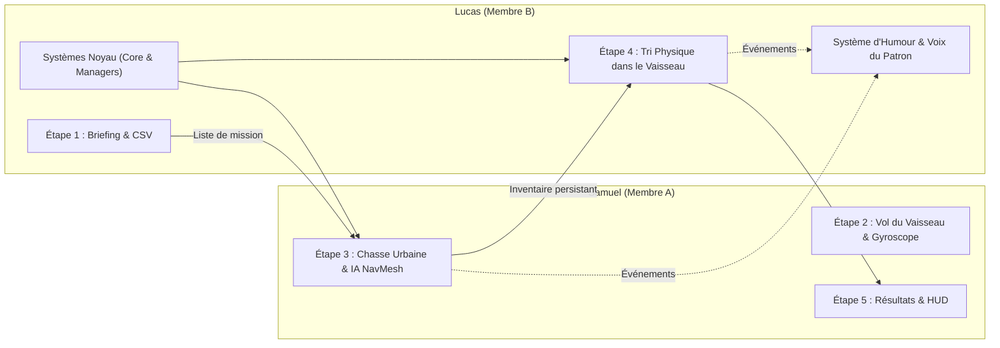

# V.A.R.G. — Abduction Méthodique

> **Projet de Jeu Vidéo (Unity 6.3 LTS)**  
> **Genre :** Action / Réflexion à la première personne (*Matcher* & *Trier*)  
> **Thème :** Humour absurde d'entreprise extraterrestre (*Make me Laugh*)  
> **Binôme :** Samuel (Membre A) & Lucas (Membre B)

---

## 1. Comment marche le jeu ?

### Concept général
Dans **V.A.R.G.** (*Voluntary Alien Retrieval Group* / *Abduction Méthodique*), le joueur incarne un petit extraterrestre employé d'une corporation interstellaire bureaucratique. Sous la pression constante d'un patron sarcastique et exigeant, il est envoyé sur Terre pour abduire des spécimens terrestres précis, avant de retourner au vaisseau pour les trier physiquement dans des cages de confinement.

Le jeu repose sur deux mécaniques principales :
1. **Le Matcher (Chasse & Mémorisation) :** capturer des cibles dans un ordre précis imposé sans consulter la liste pendant la mission.
2. **Le Trier (Tri physique) :** manipuler physiquement les animaux capturés à l'intérieur du vaisseau pour les répartir selon des quotas stricts et jeter les erreurs au broyeur.

---

### Les Cibles Terrestres
Il existe 4 types d'animaux/cibles :
* **Poule (`Chicken`)**
* **Vache (`Cow`)**
* **Cochon (`Pig`)**
* **Humain (`Human`)**

---

### Déroulement d'un Niveau (Boucle de Gameplay)

Chaque niveau se compose de 5 étapes séquentielles :

#### Étape 1 : Le Briefing du Patron (`01_BossBriefing`)
* Le patron transmet ses ordres par dialogue et présente une vitrine visuelle 3D temporaire (*TargetShowcaseUI*) affichant la séquence ordonnée des spécimens à capturer (ex. : *Vache → Poule → Vache → Cochon*).
* **Une espèce est systématiquement interdite** lors de chaque niveau (elle n'apparaît pas dans la commande). Le joueur doit mémoriser la liste et déduire l'intrus.
* La liste disparaît une fois le temps de consultation écoulé : le joueur doit **tout mémoriser**.
* *Fonctionnalité avancée :* Il est également possible de charger des niveaux personnalisés directement depuis un fichier tableur CSV (`CustomLevel.csv`).

#### Étape 2 (Extra) : Le Vol du Vaisseau (`02_ShipFlight`)
* Transition optionnelle où le joueur pilote la soucoupe volante au-dessus de la zone urbaine.
* Contrôlable au clavier ou via les **capteurs gyroscopiques d'un smartphone**, avec un geste de secousse (*shake*) pour atterrir dans la ville.

#### Étape 3 : La Chasse Urbaine (`03_CityHunt`)
* Vue à la première personne dans une ville habitée par des animaux autonomes régis par un système de navigation IA (NavMesh). Les proies se promènent et fuient à l'approche du joueur.
* Équipé d'un pistolet rétrécisseur (*Shrink Gun*), le joueur réduit et capture les cibles.
* **Règles strictes de capture :**
  * **Cible correcte dans l'ordre :** Validée et stockée dans l'inventaire. L'ordre avance.
  * **Cible présente mais hors-ordre :** Pénalité de temps immédiate (**−10 secondes**) sur le chronomètre de Chasse et perte d'une vie (**−1 vie**).
  * **Cible interdite :** Pénalité reportée sous forme de **dette de temps (−10 secondes)** qui sera prélevée au début de la phase de tri, plus perte d'une vie (**−1 vie**).
* Dès que toute la liste est complétée, le joueur rejoint le rayon tracteur (*ShipBeamZone*) sous le vaisseau pour monter à bord.

#### Étape 4 : Le Tri dans la Soute (`04_ShipSorting`)
* Les animaux capturés (bons spécimens comme erreurs) sont déversés dans un bac central sous forme de miniatures physiques.
* Le joueur utilise un système de saisie physique (*Grabbing*) pour porter, approcher/éloigner ou lancer les créatures :
  * **4 Cages dédiées :** Chacune n'accepte qu'un quota précis correspondant strictement à la commande de la mission. Déposer le bon animal valide la cage.
  * **Broyeur de Rebuts (*Discard Bin*) :** Destiné aux animaux interdits et aux surplus capturés par erreur.
  * **Erreurs de tri :** Déposer un animal dans la mauvaise cage ou dépasser le quota le renvoie au centre de la soute avec une pénalité de temps (**−5 secondes**).
  * **Erreur critique :** Jeter un animal requis dans le broyeur de rebuts déclenche une alarme, le téléporte immédiatement au centre de la soute pour pouvoir être récupéré, et coûte **−1 vie** et **−5 secondes**.

#### Étape 5 : Résultats & Évaluation (`05_Results`)
* Affichage des résultats sous forme de rapport d'évaluation bureaucratique (graphique à barres type tableur).
* Calcul du score en fonction du temps restant sur les deux chronomètres et des vies conservées.
* Dialogue comique de conclusion du patron alien (félicitations condescendantes ou réprimande), puis passage au niveau suivant, réessai ou retour au menu principal.

---

### Système de Règles & Décisions de Design
* **Double Chronomètre & Dette :** Le jeu gère deux chronomètres distincts (Chasse et Tri). Conformément à notre décision de design, il n'existe **aucun gain de temps** lors des réussites (le temps s'écoule et diminue en cas de pénalité). Les erreurs sur cibles interdites en ville sont stockées en *dette de temps* déduite dès l'entrée dans la soute.
* **Vies (5 vies par niveau) :** Atteindre 0 vie ou voir l'un des deux chronomètres expirer entraîne une défaite immédiate.

---

## 2. Répartition du Travail au sein du Binôme

Le développement a été équitablement réparti dès la phase de conception selon une architecture modulaire et des contrats stricts (évitant les conflits Git et assurant l'autonomie de chacun).

---

### Samuel (Membre A) — Chasse, IA, HUD, Résultats & Contrôles Mobiles

Samuel s'est concentré sur la jouabilité de l'étape de Chasse terrestre, la programmation des entités vivantes, les interfaces utilisateur en jeu, l'écran de résultats et l'intégration mobile :

* **Contrôleur Joueur & Caméra (`ETPlayerController`, `ETCameraLook`) :**
  * Déplacement fluide à la première personne avec gestion des collisions et caméra clampée verticalement (±85°).
  * Intégration du nouvel *Input System* d'Unity pour le clavier/souris (`KeyboardMouseInput`).
* **Système d'Interaction & Pistolet Réducteur (`PlayerInteractor`, `ShrinkGun`, `Shrinkable`, `ShrinkBeamFX`) :**
  * Détection d'interaction par lancer de rayon central (*raycast*) avec réticule réactif (`CrosshairUI`).
  * Mécanique d'amincissement/rétrécissement progressif des cibles avec faisceau visuel, sons et délai de récupération (*cooldown*).
* **Intelligence Artificielle & Navigation (`TargetAI`, `TargetSpawner`, `NavMeshSurface`) :**
  * Machine à états finis pour les proies : vagabondage aléatoire (*Wander*), pause (*Idle*), détection du joueur et fuite affolée avec cris (*Flee*), et état capturé (*Captured*).
  * Génération dynamique des cibles sur la carte en respectant les quotas et les types interdits.
* **Zone d'Évacuation (`ShipBeamZone`) :**
  * Faisceau de téléportation vers le vaisseau, actif uniquement lorsque la commande de capture est strictement complète.
* **HUD & Retours Visuels de Chasse :**
  * `HuntInventoryUI` : suivi en temps réel de la progression des captures (`Targets: X/Y`).
  * `TimerUI` & `TimeDeltaPopup` : affichage du chronomètre actif, alerte sous les 15 secondes, affichage de la dette de tri et popups d'animation de pénalité (ex. *−10s*).
  * `LivesUI` : affichage graphique des 5 vies du joueur.
* **Écran de Fin de Niveau (`05_Results`, `ResultsScreen`) :**
  * Synthèse des performances, calcul du score, graphique à barres façon tableur d'entreprise et boutons d'enchaînement de niveau.
* **Phase Extra — Vol Spatial & Contrôle Smartphone (`02_ShipFlight`, `ShipController`, `MobileShipInput`, `ShakeDetector`) :**
  * Pilotage de la soucoupe avec caméra de poursuite en vue à la 3e personne.
  * Lecture du gyroscope mobile avec calibration, zone morte et lissage, et détection des secousses (*shake*) pour déclencher la descente sur la ville.

---

### Lucas (Membre B) — Architecture Système, Tri Physique, Briefing & Humour

Lucas a conçu l'épine dorsale architecturale du projet, la persistance des données, la mécanique de tri physique en soute, le système de dialogue comique et la compatibilité tableur :

* **Architecture Système & Persistance (`Singleton<T>`, `PersistentBootstrapper`, `GameManager`, `SceneLoader`) :**
  * Mise en place du patron de conception Singleton persistant (`DontDestroyOnLoad`) garantissant qu'un lancement depuis n'importe quelle scène charge automatiquement le conteneur `[Systems]`.
  * Machine à états globale orchestrant le déroulement des niveaux, victoires, défaites et transitions de scènes sans conflit de rechargement.
* **Bus d'Événements & Découplage (`GameEvents`) :**
  * Architecture événementielle en C# pur permettant à tous les systèmes (sons, dialogues, timers, inventaire) de communiquer sans couplage direct.
* **Gestion des Données & Configuration :**
  * Création des modèles et ScriptableObjects : `TargetData`, `LevelConfig`, `CampaignConfig`, `PenaltyConfig`, `ScoringConfig`, `GameConfig`.
  * Structs de données `CapturedItem`, `LevelResult`, enums `CaptureResult`, `DefeatReason`, `TargetType`.
* **Missions, Inventaire & Chronomètres :**
  * `MissionManager` : génération algorithmique des listes de courses avec exclusion de l'espèce interdite, et validation centrale et unique des captures.
  * `InventoryManager` : inventaire persistant conservant la liste complète des cibles capturées et leur statut de validité à travers les changements de scène.
  * `TimerManager` & `LivesManager` : gestion indépendante des chronomètres, application des pénalités, calcul de la dette temporelle et décompte des 5 vies.
* **Niveau Personnalisé via Tableur (`SpreadsheetLevelLoader`, `SpreadsheetLevelData`, `CustomLevel.csv`) :**
  * Parseur permettant de concevoir et modifier des niveaux complets directement dans un tableur (Excel, LibreOffice Calc) via fichier CSV.
* **Tri Physique dans la Soute (`GrabController`, `Grabbable`, `CaptureBoxSpawner`, `Cage`, `DiscardBin`, `SortingManager`) :**
  * Scène intérieure du vaisseau avec générateur physique des miniatures d'animaux dans le bac central.
  * Système complet de saisie physique (*Grabbing*) en vue FPS : préhension d'objets sans traverser les murs, réglage de la distance à la molette, lancer dosé et faisceau tracteur visuel (`TractorBeamVisual`).
  * Cages interactives avec vérification des quotas au relâchement, renvoi automatique des intrus au centre de la soute (`ReturnToCenter`), et détection d'erreurs dans l'incinérateur.
* **Scène de Briefing & Humour Bureaucratique (`01_BossBriefing`, `BossDialogueManager`, `BossLineSet`, `BossPopupUI`, `DialogueBox`) :**
  * Interface de présentation de mission avec boîte de dialogue narrative (`DialogueBox`), avatar du patron et vitrine visuelle 3D temporaire des cibles (`TargetShowcaseUI`).
  * Système de répliques comiques choisies aléatoirement avec délai anti-spam (*cooldown*), insertion dynamique du nom de la cible capturée (`{captured}`), réprimandes réactives aux erreurs de capture et de tri, et retours sonores extraterrestres intégrés (`BossDialogueManager.PlayVoice`).

---

## 3. Matrice de Traçabilité — Pipeline du Cours

Le tableau ci-dessous atteste de la réalisation de l'ensemble des 13 étapes demandées dans les consignes du professeur :

| Étape du Pipeline | Description | Éléments & Scripts Clés | Responsable |
|:---:|:---|:---|:---:|
| **1** | **Player Controller** | `ETPlayerController`, `ETCameraLook`, `IPlayerInput` | **Samuel** |
| **2** | **Interaction avec prefabs d'objets** | `PlayerInteractor`, `IInteractable`, `TargetData`, `Target` | **Samuel & Lucas** |
| **3** | **Réduction de taille des objets** | `ShrinkGun`, `Shrinkable`, animation et sons de rétrécissement | **Samuel** |
| **4** | **Déplacement des animaux (NavMesh Agent & Surface)** | `TargetAI` (états Idle/Wander/Flee), `NavMeshSurface`, obstacles | **Samuel** |
| **5** | **Inventaire persistant pour garder les objets** | `InventoryManager`, `CapturedItem`, `HuntInventoryUI` | **Lucas & Samuel** |
| **6** | **Transition de scènes sans détruire la liste** | `SceneLoader`, `PersistentBootstrapper`, `DontDestroyOnLoad` | **Lucas** |
| **7** | **Mécanique inverse de dépôt d'un objet de la liste** | `ShipBeamZone` (dépôt global) & `CaptureBoxSpawner` (apparition en soute) | **Samuel & Lucas** |
| **8** | **Déplacement d'objet par Grabbing** | `GrabController`, `Grabbable`, manipulation physique par `linearVelocity` | **Lucas** |
| **9** | **Trigger box & Colliders pour tester l'objet** | `Cage`, `DiscardBin`, `SortingManager`, validation des quotas | **Lucas** |
| **10** | **Timer pour gagner ou perdre du temps** | `TimerManager`, `TimerUI` *(Choix de design : perte de temps et système de dette)* | **Lucas & Samuel** |
| **11** | **Scène/Menu avec animaux à chercher et mémoriser** | `01_BossBriefing`, `BriefingController`, `TargetShowcaseUI` | **Lucas** |
| **12** | **Scripts d'humour** | `BossDialogueManager`, `BossLineSet`, `BossPopupUI`, `DialogueBox` | **Lucas** |
| **13** | **Contrôles avec téléphone** | `MobileShipInput` (gyroscope, calibration, lissage) & `ShakeDetector` | **Samuel** |

---

## 4. Spécifications Techniques

* **Moteur :** Unity 6.3 LTS (C#).
* **Physique & API Moderne :** Utilisation stricte des nouvelles APIs Unity 6 (`linearVelocity`, `linearDamping`, `FindObjectsByType`, `NavMeshSurface`).
* **Input System :** `UnityEngine.InputSystem` avec gestion unifiée des contrôles clavier/souris et capteurs mobiles.
* **Contrainte de Poids (< 10 MB) :**
  * Aucun package tiers lourd ou plugin externe (pas de Cinemachine, pas de ProBuilder).
  * Modélisation et primitives légères, optimisation des textures et des polices TextMeshPro.
  * Compression maximale pour respecter le seuil strict imposé pour le livrable final.

---

## 5. Démarrage Rapide

1. Ouvrir le projet dans **Unity 6.3 LTS**.
2. Charger et lancer la scène **`00_Boot`** (située dans `Assets/_Project/Scenes/00_Boot.unity`) pour initialiser l'ensemble des systèmes.
   * *Note :* Grâce au `PersistentBootstrapper`, il est également possible d'appuyer directement sur **Play** depuis n'importe quelle scène (`01_BossBriefing`, `03_CityHunt`, `04_ShipSorting`) pour la tester isolément en mode débogage.
3. **Touches de contrôle (PC Clavier/Souris) :**
   * `Z, Q, S, D` ou `W, A, S, D` : Déplacement du joueur / Déplacement de la soucoupe.
   * `Souris` : Orientation du regard.
   * `Clic Gauche` : Tirer au pistolet réducteur (en ville) / Saisir et lâcher un objet (dans la soute).
   * `Clic Droit` : Lancer l'objet tenu (dans la soute).
   * `Molette Souris` : Rapprocher ou éloigner l'objet tenu.
   * `E` / `Espace` : Interagir / Avancer le Briefing / Atterrir en ville lors de la phase de vol.
   * `C` : Recalibrer la position neutre du gyroscope (phase de vol).

---

## 6. Configuration du Contrôle par Smartphone (Étape 2 — Vol du Vaisseau)

Lors de l'Étape 2 (`02_ShipFlight`), la soucoupe volante peut être pilotée directement à l'aide des capteurs gyroscopiques d'un smartphone.

### Prérequis
* Un smartphone (Android ou iOS) et l'ordinateur exécutant le jeu doivent être **connectés au même réseau local (même Wi-Fi)**.
* Une application de transmission de capteurs via protocole OSC, telle que **MultiSense OSC** (recommandée) ou toute application similaire de streaming de capteurs UDP/OSC (ex. *ZIG SIM*).

### Procédure de Connexion
1. **Trouver l'adresse IP locale du PC :**
   * Sous Windows : ouvrez l'invite de commande (`cmd`) et tapez `ipconfig` (recherchez l'adresse IPv4, ex. `192.168.1.45`).
   * Sous Linux / macOS : ouvrez un terminal et tapez `ip a` ou `ifconfig`.
2. **Configurer l'application sur le téléphone :**
   * **Target IP (Adresse IP cible) :** Entrez l'adresse IP locale de votre PC relevée à l'étape 1.
   * **Port :** Indiquez le port **`5555`** (protocole UDP).
   * **Capteurs à activer :** Activez l'**Accéléromètre** (*Accelerometer*) et le **Gyroscope** (*Gyroscope*).
   * Lancez la transmission des données (*Start / Send*).

### Utilisation en Jeu
* **Pilotage par inclinaison :** Inclinez le téléphone en avant/arrière (tangage) et vers la gauche/droite (roulis) pour diriger la soucoupe. Le système intègre un filtrage d'orientation (*sensor fusion*), une zone morte et un lissage de trajectoire.
* **Calibration :** La position neutre est calibrée dès les premiers paquets reçus. Vous pouvez réinitialiser la position neutre à tout moment en appuyant sur la touche **`C`** du clavier.
* **Atterrissage par secousse (*Shake*) :** Une fois la soucoupe au-dessus de la ville (zone d'atterrissage), **secouez énergiquement le téléphone**. Le détecteur d'accélération (*ShakeDetector*) enregistre les pics de force G et déclenche l'atterrissage vers la phase de Chasse urbaine.
* **Secours clavier :** Les commandes clavier (`Z, Q, S, D` et touche `E` pour atterrir) restent disponibles et prioritaires à tout moment en cas d'absence ou de déconnexion du smartphone.

---

## 7. Système de Niveaux Personnalisés via Tableur CSV (`CustomLevel.csv`)

En parfaite adéquation avec le thème parodique de bureaucratie d'entreprise extraterrestre et de gestion par feuilles de calcul, le jeu intègre un système complet de conception de niveau via fichier tableur externe (`CustomLevel.csv`).

Cette fonctionnalité permet de concevoir, modifier et équilibrer des niveaux personnalisés dans un logiciel tiers (Microsoft Excel, LibreOffice Calc, Google Sheets ou un simple éditeur de texte) sans jamais devoir recompiler le jeu ni ouvrir l'éditeur Unity.

### Structure du Fichier `CustomLevel.csv`
Le fichier est situé à la racine du projet (`CustomLevel.csv`). S'il est absent, le jeu génère automatiquement un modèle pré-rempli et documenté lors du démarrage.

Le fichier s'articule autour de 4 colonnes (`Parameter,Value,DefaultValue,Description`) et accepte les délimiteurs virgule (`,`) ou point-virgule (`;`) :

| Paramètre | Exemple de Valeur | Description |
|---|---|---|
| `TargetSequence` | `"Cow, Pig, Chicken, Cow"` | Liste ordonnée exacte des cibles à abduire. Accepte les espèces `Cow`, `Pig`, `Chicken`, `Human` (ou équivalents : `Vache`, `Cochon`, `Poule`, `Humain`). |
| `ForbiddenTarget` | `Human` | Espèce interdite pour ce niveau. **Règle absolue :** ne doit pas figurer dans `TargetSequence`. |
| `CaptureTime` | `90` | Temps alloué en secondes pour le chronomètre de la Chasse urbaine. |
| `SortingTime` | `45` | Temps alloué en secondes pour le chronomètre du Tri en soute. |
| `ExtraSpawns` | `2` | Nombre d'animaux distracteurs supplémentaires générés en ville pour corser la déduction. |
| `ForbiddenSpawns` | `2` | Nombre de spécimens de l'espèce interdite injectés sur la carte pour piéger le joueur. |
| `FleeSpeedMultiplier` | `1.0` | Multiplicateur de vitesse de fuite des animaux face au joueur (entre `0.2` et `3.0`). |

### Comment l'Utiliser

Il existe deux manières directes de charger et tester un niveau personnalisé :

#### Méthode 1 : Depuis le Menu Principal (`00_Boot`)
1. Cliquer sur le bouton **`OPEN SPREADSHEET (EXCEL)`** : le jeu ouvre directement le fichier `CustomLevel.csv` dans le tableur par défaut du système d'exploitation.
2. Éditer les paramètres souhaités (séquence d'animaux, espèce interdite, temps limites, vitesse) et enregistrer le fichier (`Ctrl + S`).
3. Revenir sur le jeu et cliquer sur **`PLAY CUSTOM (SPREADSHEET)`** : le jeu analyse le fichier, configure le niveau personnalisé et démarre automatiquement la partie.

#### Méthode 2 : Depuis la Scène de Briefing (`01_BossBriefing`)
1. Lors de la phase de Briefing avec le patron extraterrestre, cliquer sur le bouton **`[SPREADSHEET LEVEL]`** situé dans le coin supérieur droit de l'écran.
2. Le `SpreadsheetLevelLoader` injecte immédiatement la configuration dans le `GameManager` et le `MissionManager`.
3. Le titre de la mission passe à `CAPTURE MISSION | CUSTOM SPREADSHEET LEVEL`, le bouton se valide (`[SPREADSHEET LOADED]`), et le patron réagit en direct pour valider la commande envoyée par le quartier général.

### Sécurité et Validation des Données
Le chargeur (`SpreadsheetLevelLoader`) intègre un mécanisme de validation robuste :
* Si la liste `TargetSequence` est vide ou invalide, le chargement est rejeté.
* Si le joueur inscrit l'espèce interdite `ForbiddenTarget` au sein de la séquence de capture, l'erreur est détectée et le chargement est bloqué.
* En cas d'erreur de saisie, le jeu affiche un avertissement explicite à l'écran et le patron extraterrestre interpelle le joueur avec un dialogue signalant l'erreur de saisie dans la matrice.

