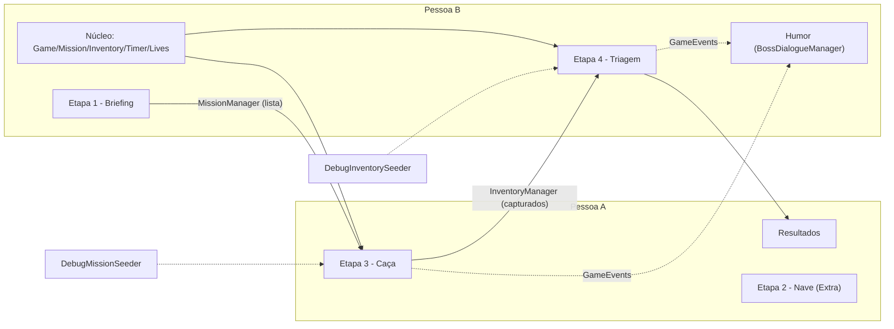

# Divisão de Tarefas — Dupla de Desenvolvimento

> Baseado em [GDD_Tecnico.md](./GDD_Tecnico.md) (fonte da verdade: regras na **§R**, contratos na **§C**). Regras para o Antigravity em [AGENTS.md](./AGENTS.md).
> **Divisão por etapa:**
> - **Pessoa A — Etapa 3 (Caça / Matcher)** + HUD da caça + Resultados + Fase Extra (nave/celular)
> - **Pessoa B — Etapa 4 (Triagem / Trier)** + núcleo (managers) + Briefing + Humor

---

## Cronograma (❓ P1 — preencher quando o prazo for definido)
| Sprint | Início | Fim | Marco |
|---|---|---|---|
| 0 | | | Projeto criado, contratos congelados, build vazia medida |
| 1 | | | Managers + jogador + alvos placeholder |
| 2 | | | 1ª integração: Caça → inventário → Triagem |
| 3 | | | Loop completo no PC (níveis, briefing, humor, resultados) |
| 4 | | | Polimento + build < 10 MB + playtest |
| Extra | | | Nave + celular |
| Folga | | Entrega | Reservar **≥ 15% do prazo** para bugs, relatório e vídeo |

---

## Donos (quem pode editar o quê)
| Pessoa A | Pessoa B | Só juntos (via PR combinado) |
|---|---|---|
| Cenas `02_ShipFlight`, `03_CityHunt`, `05_Results` | Cenas `00_Boot`, `01_BossBriefing`, `04_ShipSorting` | `ProjectSettings/` (layers, tags, input, Build Settings) |
| Prefab `ETPlayer` (base), prefabs `Target_*` e `Mini_*` | Prefab `[Systems]`, Prefab Variant `ETPlayer_Sorting`, gaiolas, descarte | `Packages/manifest.json` |
| Pastas `Player`, `Targets`, `Ship`, `Input` | Pastas `Core`, `Mission`, `Inventory`, `Sorting`, `Humor`, `Data`, `Debug` | Arquivos da §C do GDD (contratos) |
| UI: `HuntInventoryUI`, `TimerUI`, `LivesUI`, `TimeDeltaPopup`, `CrosshairUI`, `ResultsScreen`, `PauseMenu` | UI: kit planilha (`Spreadsheet*`, `FormulaBar`, `SheetTabs`), `SceneTransitionUI`, Briefing, `BossPopupUI` | `GDD_Tecnico.md`, `Tasks_Divisao_Dupla.md`, `AGENTS.md` |

## Como uma etapa não trava a outra
1. **Contratos congelados no Sprint 0** (GDD §C): enums, SOs, interfaces, APIs dos managers, eventos, layers. Mudou contrato → combina com o colega → atualiza o GDD → só então muda o código.
2. **A B entrega o núcleo cedo (Sprint 1):** todos os managers funcionando. Toda regra de captura fica em `MissionManager.ValidateCapture()` (dono: B) — a A só chama.
3. **Ponto de contato entre as cenas: `InventoryManager`.** A Caça escreve, a Triagem lê.
4. **Seeders de debug:** `DebugMissionSeeder` (A testa a Caça sem o Briefing) e `DebugInventorySeeder` (B testa a Triagem sem a Caça).
5. **`PersistentBootstrapper`:** Play em qualquer cena carrega `[Systems]`.
6. **Git:** `main` ← `dev` ← `feature/A07-target-ai` / `feature/B05-mission-manager`. *Force Text*, `.meta` sempre commitados, `.gitignore` da Unity, Git LFS para `.fbx/.wav/.png`, UnityYAMLMerge (Smart Merge) configurado. PR revisado pelo colega; `dev` sempre compilando.

## Formato das tarefas
Cada tarefa tem: **Arquivos** · **Depende de** · **Pronto quando** (critério testável). Para o Antigravity, peça por ID: *"Implemente a tarefa B05 seguindo o GDD §C.3 e §R.5"*. Ao terminar: marcar `[x]`, abrir PR.

---

## Sprint 0 — Setup e contratos (JUNTOS)
- [x] **S0.1** Criar projeto **Unity 6.3 LTS** (mesma versão exata nos dois PCs), repositório, `.gitignore`, LFS, Smart Merge.
- [ ] **S0.2** Medir build vazia (URP mínimo vs Built-in) → escolher pipeline; remover pacotes não usados; instalar Input System e AI Navigation. *Pronto quando:* tamanho anotado aqui: `____ MB`.
- [ ] **S0.3** Player Settings: Active Input Handling = **Input System Package (New)**; IL2CPP; stripping High.
- [x] **S0.4** Estrutura de pastas (GDD §0.4), layers/tags e Collision Matrix (§C.5), as 6 cenas vazias registradas no Build Settings.
- [x] **S0.5** Escrever os **contratos** (§C.1–C.4) — só assinaturas, métodos vazios: enums, SOs, `CapturedItem`, `IPlayerInput`, `IShipInput`, `IInteractable`, APIs dos managers, `GameEvents`.
- [x] **S0.6** `Singleton<T>`, `PersistentBootstrapper`, prefab `[Systems]` com **todos** os managers (stubs) em `Resources/`.
- [x] **S0.7** Criar assets: 4 `TargetData`, `CampaignConfig` com 3 `LevelConfig` (§R.2), `PenaltyConfig`, `ScoringConfig`, `GameConfig`.
- [ ] **S0.8** Combinar o tema visual de planilha (cores, fonte, tamanho de célula) e a textura-paleta 64×64.
- *Pronto quando:* projeto compila nos dois PCs, Play em qualquer cena cria `[Systems]` sem erro.

---

## Pessoa A — Caça + HUD + Resultados

### Sprint 1 — Jogador e alvos placeholder (Passos 1, 2)
- [x] **A01** `InputManager` + `KeyboardMouseInput` (mapa `OnFoot` e `UI`).
  - Arquivos: `Input/*` · Depende: S0.5 · Pronto quando: valores de `IPlayerInput` aparecem num log de debug.
- [x] **A02** Prefab **`ETPlayer`**: `ETPlayerController` + `ETCameraLook` (pitch ±85°, cursor travado). *Entregar cedo — B cria a Variant.*
  - Depende: A01 · Pronto quando: anda, olha, não atravessa paredes, consegue olhar para cima.
- [x] **A03** `PyramidMeshGenerator` (Editor) + prefabs placeholder `Target_*` (com `NavMeshAgent`, layer `Interactable`) e `Mini_*` (com `Rigidbody`, layer `Grabbable`) das 4 primitivas (§R.1); ligar nos `TargetData`.
  - Depende: S0.7 · Pronto quando: os 8 prefabs existem e cada `TargetData` aponta para seu `prefab` e `miniPrefab`.
- [x] **A04** Greybox de `03_CityHunt` (chão, casas-cubo, limites fechados, nave visível no céu).
- [x] **A05** `IInteractable` + `PlayerInteractor` (raycast central) + `CrosshairUI`.
  - Depende: A02, A03 · Pronto quando: a mira muda de cor ao apontar para um alvo.

### Sprint 2 — Captura (Passos 3, 4)
- [x] **A06** `Target.cs` + `ShrinkGun` + `Shrinkable` + `ShrinkBeamFX` (cooldown 0.6 s); ao encolher chama `MissionManager.ValidateCapture()`.
  - Depende: A05, B05 · Pronto quando: alvo encolhe com "boing", some, e aparece no inventário com o `CaptureResult` certo (ver no Inspector/log).
- [ ] **A07** `NavMeshSurface` + obstáculos + bake; `TargetAI` (Wander/Idle/Flee/Captured, tick 0.2–0.5 s).
  - Pronto quando: alvos passeiam, fogem do jogador, não saem do mapa.
- [ ] **A08** `TargetSpawner` + `SpawnPoint` (regra §R.2: `k + extra` por tipo da lista + proibidos).
  - Depende: B05, B06 · Pronto quando: com o `DebugMissionSeeder`, a quantidade de cada tipo no mapa bate com a regra.
- [ ] **A09** `ShipBeamZone`: sobe só com `IsComplete`; senão `OnBeamDenied`.
  - Pronto quando: com ordem incompleta o feixe recusa; completa → para o Timer de Captura e carrega `04_ShipSorting`.

### Sprint 3 — HUD, Resultados e pause (Passos 5, 10)
- [ ] **A10** `HuntInventoryUI` (capturados com ✔/⚠/✖, nunca o próximo; `Ordem: 2/4`; barra de fórmulas). Usa kit da B (B07).
- [ ] **A11** `TimerUI` (Captura + dívida da Triagem, vermelho < 15 s), `TimeDeltaPopup`, `LivesUI`.
  - Pronto quando: cada erro mostra "−10" e uma vida piscando; dívida aparece na Caça.
- [ ] **A12** Ligar o Timer de Captura à cena (start ao entrar, stop no feixe, derrota no zero).
- [ ] **A13** Cena `05_Results` + `ResultsScreen`: tempos restantes, vidas, erros, score (§R.7), gráfico de barras estilo Excel, botões "Próximo nível"/"Tentar de novo".
  - Depende: B01 (`LastResult`).
- [ ] **A14** `PauseMenu` (Esc): pausa timers, destrava cursor, botões Continuar/Reiniciar nível.

### Sprint 4 — Polimento da Caça
- [ ] **A15** Balanceamento: velocidades de fuga, spawns extras, tempos de captura dos níveis 1–3 (preencher `LevelConfig`).
- [ ] **A16** Feedback: som/partículas da captura, alvos "gritando" ao fugir.
- [ ] **A17** Arte low-poly (cidade, ET, nave, 4 alvos) substituindo as primitivas, com textura-paleta única.
- [ ] **A18** Otimização da cidade (polígonos, nº de agentes) — medir build.

---

## Pessoa B — Núcleo + Triagem + Briefing + Humor

### Sprint 1 — Núcleo (Passos 5, 6, 10) — *prioridade máxima, A depende disso*
- [x] **B01** `GameManager` (`StartLevel`, `GoToHunt` respeitando `useShipFlight`, `GoToSorting`, `Victory`, `Defeat`, `NextLevel`, `RetryLevel`, `LastResult` com score §R.7) + `SceneLoader` + `SceneTransitionUI`.
  - Pronto quando: dá para percorrer as cenas por botões de debug; reset de nível limpa tudo.
- [x] **B02** `InventoryManager` completo (`CapturedItem`, eventos).
- [x] **B03** `TimerManager` completo: 2 timers, `ApplyPenalty`, **dívida** de Sorting, `Pause`, `OnTimeLow`, `OnTimeUp`. **Sem ganho de tempo.**
  - Pronto quando: penalidade em Sorting durante a Caça vira dívida e é descontada no `StartTimer(Sorting)`.
- [x] **B04** `LivesManager` (5 vidas, `OnLifeLost`, derrota em 0).
- [x] **B05** `MissionManager` completo: `GenerateMission` (§R.2: 1 tipo proibido, 3 tipos na lista, repetição permitida) + `ValidateCapture` (§R.5: penalidades, vida, inventário, eventos, avanço da ordem).
  - Pronto quando: um teste (EditMode ou botão de debug) cobre os 3 resultados e confirma que a ordem só avança com `Correct`.
- [x] **B06** `GameEvents` (§C.4, com limpeza em `SubsystemRegistration`) + `DebugMissionSeeder` + `DebugInventorySeeder` (itens dos 3 resultados).
- [ ] **B07** Kit UI planilha: `SpreadsheetPanel`, `SpreadsheetRow`, `SpreadsheetCell`, `FormulaBar`, `SheetTabs`. *A usa no Sprint 3.*

### Sprint 2 — Triagem (Passos 7, 8, 9)
- [ ] **B08** Greybox de `04_ShipSorting` (interior da nave, caixa, 4 gaiolas + lixeira) + Prefab Variant `ETPlayer_Sorting`.
  - Depende: A02.
- [ ] **B09** `CaptureBoxSpawner` + `SortableItem` (instancia `miniPrefab` de cada `CapturedItem`).
  - Depende: A03 · Pronto quando: com o `DebugInventorySeeder`, os minis certos aparecem na caixa.
- [ ] **B10** `GrabController` + `Grabbable` (velocidade via `linearVelocity`, arremesso, scroll, `IsHeld`) + `HighlightOnHover`.
- [ ] **B11** `Cage` + `DiscardBin` + `SortingManager` (§R.6: validar só após soltar; cuspir; descarte errado tira vida).
  - Pronto quando: os 4 casos da tabela §R.6 funcionam e a fase termina com caixa vazia.
- [ ] **B12** `KillZoneRespawn` + Timer de Separação ligado à cena (start com dívida, stop no fim, derrota no zero).

### Sprint 3 — Briefing e Humor (Passos 11, 12)
- [ ] **B13** Cena `01_BossBriefing`: `BriefingController`, `DialogueBox`, `TypewriterText`, `SpreadsheetTableUI`; lista com tempo limitado; mostra o nível.
  - Pronto quando: a lista some ao continuar e nunca mais aparece no nível.
- [ ] **B14** `BossLineSet` + `BossDialogueManager` (shuffle bag, tokens, escalonamento por vidas perdidas, cooldown, `OnIdle`).
- [ ] **B15** `BossPopupUI` (comentário de célula) + `AlienVoice` (bipes).
- [ ] **B16** Progressão de níveis: `NextLevel` usa o próximo `LevelConfig`; após o último, repete com +1 item e +10 s.

### Sprint 4 — Polimento da Triagem + Build (#6)
- [ ] **B17** Feedback das gaiolas (ding, cuspe cômico, partículas), balanceamento do Timer de Separação.
- [ ] **B18** Arte low-poly: interior da nave, gaiolas, lixeira, chefe.
- [ ] **B19** Otimização de tamanho: atlas TMP reduzido, compressão, stripping, LZ4HC; auditoria com Build Report (compilado final compactado **< 10 MB**).

---

## Fase Extra — Etapa 2: Nave + Celular (Passo 13 / #25)
> Só começa com o loop principal completo no PC (fim do Sprint 4). O celular é usado **apenas** nesta cena. Arquitetura do celular ❓ P3 — confirmar com o professor antes do X3.

- [ ] **X1 [A]** Cena `02_ShipFlight`: `ShipController`, `ShipFollowCamera`, `LandingZone`, `KeyboardShipInput`; ligar `GameConfig.useShipFlight = true`.
  - Pronto quando: Briefing → voo → pousar com E → Caça.
- [ ] **X2 [A]** Teste rápido de viabilidade (*spike*) da ponte celular ↔ jogo (pode ser antecipado para quando o professor responder).
- [ ] **X3 [A]** `MobileShipInput` (giroscópio com calibração, deadzone, suavização) + `ShakeDetector` (descer).
- [ ] **X4 [B]** `GyroCalibrationUI` + visual dos controles no tema planilha.
- [ ] **X5 [A+B]** Teste no aparelho e checagem de tamanho final.

---

## Rastreabilidade — Pipeline do professor
| Passo do professor | GDD | Tarefas | Dono |
|---|---|---|---|
| 1. Player Controller | Passo 1 | A01, A02 | A |
| 2. Interação com prefabs | Passo 2 | A03, A05, A06, B05 | A/B |
| 3. Redução de tamanho | Passo 3 | A06 | A |
| 4. NavMesh agent/surface | Passo 4 | A07, A08 | A |
| 5. Inventário | Passo 5 | B02, A10 | B/A |
| 6. Transição de cenas mantendo a lista | Passo 6 | S0.6, B01, B06 | B |
| 7. Mecânica inversa (depósito) | Passo 7 | A09, B09 | A/B |
| 8. Grabbing | Passo 8 | B10 | B |
| 9. Trigger box / colliders | Passo 9 | B11 | B |
| 10. Timer (ganhar/perder tempo) | Passo 10 | B03, B04, A11, A12, B12 | B/A |
| 11. Menu com a lista para memorizar | Passo 11 | B13, B16 | B |
| 12. Script de humor | Passo 12 | B14, B15 | B |
| 13. Controles com telefone | Passo 13 | X1–X5 | A/B |

> Passo 10: o professor fala em "ganhar ou perder tempo"; nosso design decidiu **só perder** (sem ganho com acertos) — mencionar no relatório como decisão de design.

---

## Momentos de trabalho em conjunto
| Quando | O quê |
|---|---|
| Sprint 0 | Setup, contratos, assets de dados, tema visual (juntos). |
| Meio do Sprint 1 | A entrega `ETPlayer` + prefabs placeholder; B entrega `MissionManager`/`InventoryManager`/`TimerManager`/`LivesManager`. |
| Fim Sprint 2 | **1ª integração:** captura real → inventário → minis na Triagem (sem seeders). |
| Fim Sprint 3 | **Loop completo no PC, 3 níveis:** Briefing → Caça → Triagem → Resultados → próximo nível, com falas do chefe. |
| Fim Sprint 4 | Jogo polido, build medida, playtest com pessoas de fora. |
| Fase Extra | Nave + celular; playtest final. |

## Tarefas compartilhadas
- [ ] Escrever as piadas do chefe (os dois escrevem, B implementa).
- [ ] Efeitos sonoros curtos (bipes, boing, ding, cuspe).
- [ ] Playtest ao fim de cada sprint + balanceamento (tempos, penalidades, tamanho das listas).
- [ ] Medir o tamanho da build ao fim de cada sprint.
- [ ] Relatório acadêmico e vídeo de apresentação.
